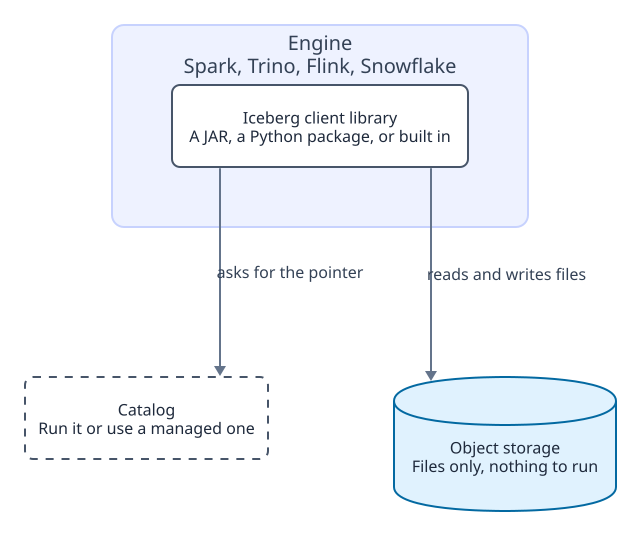

# Apache Iceberg {#apache-iceberg}

> type: category

How does Iceberg work, and how do you use it? Start from Snowflake. One product there owns three jobs: it stores the bytes, it tracks the table metadata, and it runs the compute. Iceberg breaks those three jobs apart and standardizes the middle one. Your rows sit in ordinary Parquet files in object storage that you own. S3 is the common choice, but GCS, ADLS, HDFS, and MinIO work the same way; Iceberg is not S3-native and uses no proprietary storage. Next to those data files, Iceberg keeps a small set of metadata files. They record which Parquet files form the table right now, the schema, the partition rules, and per-file statistics such as row counts and column minimum and maximum values. That metadata is the table format. Iceberg is a written specification, so it runs no queries and stores no bytes itself.

Two external parts complete the picture. A catalog holds one pointer per table: the location of the table's current metadata file. Each commit writes new files, then swaps that pointer in one atomic step. This swap is what makes a write ACID, and it is what gives you snapshots and time travel. Common catalogs are the Iceberg REST catalog, AWS Glue, Apache Polaris, Project Nessie, Unity Catalog, and Snowflake Open Catalog. An engine is the compute. It asks the catalog for the pointer, reads the metadata, skips the files that cannot match the query, and runs the SQL. Spark, Trino, Flink, DuckDB, BigQuery, Athena, and Snowflake can all act as the engine. The payoff is that several engines share one copy of the data, with no exports and no copies. Your work stays SQL and modeling, so a dbt model can materialize as an Iceberg table. You keep the Snowflake behavior you expect, such as atomic commits, time travel, and schema evolution, on files you own and any engine can read.

## Basics {#iceberg-basics}

> type: category

### What Is Iceberg? {#what-is-iceberg}

> type: concept

> edge.contrasts: hive-style-table

Iceberg is a table format. It keeps a list of the exact files that form a table at one point in time, together with the schema, the partition rules, and per-file statistics. Because the file list is explicit metadata, an engine knows the table content without scanning storage, and a change becomes visible in one atomic step.

### Table Format vs File Format {#table-format-vs-file-format}

> type: concept

A file format defines how rows are stored inside one file. Parquet, ORC, and Avro are file formats. A table format defines which files belong to the table, what the columns mean, and how a change is committed. Iceberg does not replace Parquet; it organizes Parquet files into a table.

### Hive-Style Directory Table {#hive-style-table}

> type: concept

In the older model, a directory path is the table and a subdirectory is a partition. The engine must list storage to find the data, so the listing is slow and eventually inconsistent. There is no atomic commit, so a reader can see a partly written result. Renaming a column, or changing the partition layout, usually needs a full rewrite.

### Iceberg Is Only a Specification {#iceberg-is-a-spec}

> type: warning

Iceberg is not a query engine, not a storage system, and not a database. It defines metadata files and rules. You still need an engine to run queries, a catalog to hold the table pointer, and object storage to hold the files.

## Table Anatomy {#table-anatomy}

> type: category

The metadata forms a small tree. One pointer in the catalog leads to a metadata file, the metadata file names a snapshot, the snapshot names a manifest list, and the manifest list names the manifests that list the data files.

### Catalog Pointer {#catalog-pointer}

> type: concept

The catalog stores one value per table: the location of the current metadata file. A commit replaces that value. All readers start here, so the pointer defines what the table is right now.

### Metadata File {#metadata-file}

> type: concept

The metadata file, usually a JSON file, holds the table state: the schemas, the partition specs, the sort orders, the table properties, the list of snapshots, and which snapshot is current. Each commit writes a new metadata file instead of editing the old one.

#### Schema {#table-schema}

> type: concept

The schema lists the columns with a stable field ID for each one. Engines match columns by field ID, not by name or position. This is why a rename does not break old data files.

#### Partition Spec {#partition-spec}

> type: concept

The partition spec defines how partition values come from source columns, for example `day(event_time)`. A table can hold several specs, because the spec can change over time. Each data file records which spec produced it.

#### Snapshot {#snapshot}

> type: concept

A snapshot is the complete set of data files at one commit. It has an ID, a timestamp, a summary of the operation, and a link to one manifest list. Old snapshots stay in the metadata file until you expire them.

### Manifest List {#manifest-list}

> type: concept

Each snapshot has one manifest list. It names the manifests in the snapshot and, for each one, the partition value ranges and the file counts. This lets an engine skip whole manifests before it reads them.

### Manifest File {#manifest-file}

> type: concept

A manifest lists data files. For each file it records the path, the partition values, the row count, the file size, and column statistics such as minimum, maximum, and null counts. These statistics make file pruning possible without opening the files.

### Data Files {#data-files}

> type: concept

The data files hold the rows, normally as Parquet, and sometimes as ORC or Avro. They live in object storage such as S3, GCS, ADLS, or HDFS. They are immutable: a writer adds new files and never edits a committed one.

### Delete Files {#delete-files}

> type: concept

A delete file marks rows as removed without rewriting the data file. A position delete names a file and the row positions inside it. An equality delete names column values that must disappear. Readers apply the delete files that belong to the snapshot.

## Write & Read Path {#write-and-read-path}

> type: category

The write path shows how a change becomes visible. The read path shows how a query uses the metadata to touch as few files as possible.

### Write Path {#write-path}

> type: procedure

#### Writer Plans the Write {#write-plan}

> type: step
> edge.next: write-data-files

The engine reads the table pointer from the catalog and loads the current metadata file. From it the engine takes the schema, the current partition spec, and the sort order it must follow.

#### Writer Writes Data Files {#write-data-files}

> type: step
> edge.next: write-manifests

The engine writes the new rows into new data files in storage. Nothing that already exists is changed, so the current snapshot stays readable during the write.

#### Writer Writes Manifests {#write-manifests}

> type: step
> edge.next: write-metadata-file

The engine records the new files, with their partition values and column statistics, in one or more manifests. It then writes a manifest list for the new snapshot, reusing the manifests that did not change.

#### Writer Builds New Metadata File {#write-metadata-file}

> type: step
> edge.next: write-commit-swap

The engine writes a new metadata file. It adds the new snapshot, points the current snapshot at it, and keeps the older snapshots in the list. A REST catalog works another way: the engine sends the changes, and the catalog server writes this file into your storage ([Commit Through a REST Catalog](#rest-commit)).

#### Catalog Swaps the Pointer {#write-commit-swap}

> type: step

The catalog moves the table pointer from the old metadata file to the new one in one atomic operation. This swap is the commit. Until it happens, the new files are invisible; after it happens, they are fully visible.

### Read Path {#read-path}

> type: procedure

#### Engine Asks the Catalog {#read-resolve-pointer}

> type: step
> edge.next: read-pick-snapshot

The engine reads the table pointer and loads the current metadata file. It never lists storage directories to discover the table content.

#### Engine Picks a Snapshot {#read-pick-snapshot}

> type: step
> edge.next: read-prune-manifests

Normally the engine uses the current snapshot, so the whole query reads one consistent version. A time-travel query selects an older snapshot by ID or by timestamp instead.

#### Engine Prunes Manifests {#read-prune-manifests}

> type: step
> edge.next: read-prune-files

The engine compares the query filter against the partition ranges in the manifest list. Manifests that cannot hold a matching row are skipped.

#### Engine Prunes Data Files {#read-prune-files}

> type: step
> edge.next: read-rows

Inside the remaining manifests, the engine compares the filter against each file's partition values and column statistics. Files that cannot match are skipped without being opened.

#### Engine Reads Rows {#read-rows}

> type: step

The engine reads the surviving data files, and reads only the needed columns. If the snapshot has delete files that apply, the engine uses them to drop the deleted rows from the result.

### Concurrency Control {#concurrency-control}

> type: concept

Two writers can work at the same time, because each one writes its own files and its own metadata file. Only the pointer swap must be serialized, and the catalog guarantees that. The writer that loses the race revalidates its change against the new current snapshot and retries. Conflicts are therefore detected in metadata, not by locking data files.

### Row-Level Changes {#row-level-changes}

> type: concept

An update or a delete needs a decision: rewrite the affected data files now, or record the change and resolve it at read time. Both options are valid, and a table can set them per operation.

#### Copy-on-Write {#copy-on-write}

> type: concept

The writer rewrites every data file that holds an affected row. Writes cost more, and reads stay fast because there is nothing extra to merge. This suits tables that change in large, infrequent batches.

#### Merge-on-Read {#merge-on-read}

> type: concept

> edge.contrasts: copy-on-write

The writer keeps the data files and writes delete files instead. Writes are fast, and reads cost more because the engine must apply the deletes. This suits frequent small changes, and it needs regular compaction.

## Evolution & Time Travel {#evolution-and-time-travel}

> type: category

Because the table is described by metadata, several changes that once needed a rewrite become metadata operations.

### Schema Evolution {#schema-evolution}

> type: concept

You can add, drop, rename, reorder, and widen columns without rewriting data. Field IDs keep the mapping stable, so an old file that lacks a new column simply returns null for it. Iceberg also prevents unsafe changes, such as a type change that would lose data.

### Hidden Partitioning {#hidden-partitioning}

> type: concept

The partition value is derived from a source column by a transform recorded in the spec. Queries filter on the real column, for example `event_time`, and the engine derives the partition itself. You do not add a separate partition column, and a query does not break when the partition rule changes.

#### Partition Transforms {#partition-transforms}

> type: concept

The common transforms are `identity`, `year`, `month`, `day`, `hour`, `bucket(N, col)`, and `truncate(N, col)`. Time transforms group rows by period. `bucket` spreads values evenly by hash, which suits high-cardinality keys.

#### Partitioning Still Needs Design {#partition-design-warning}

> type: warning

Hidden partitioning removes the extra column, not the need to think. Too fine a granularity, such as `hour` on a small table, creates many tiny files and slow planning. Choose the granularity from the data volume and the usual query filters.

### Partition Evolution {#partition-evolution}

> type: concept

You can change the partition spec, for example from `day` to `hour`, without rewriting history. Old files keep the spec that produced them, new files use the new spec, and the engine plans across both.

### Time Travel {#time-travel}

> type: concept

Because old snapshots stay listed in the metadata file, you can query the table as it was, by snapshot ID or by timestamp. This is useful for audits, for comparing results, and for debugging a bad load.

#### Rollback {#rollback}

> type: concept

Rollback sets the current snapshot back to an earlier one. The bad commit stops being visible, and no data file is rewritten. It is the fastest repair after a wrong write.

#### Branches & Tags {#branches-and-tags}

> type: concept

A branch and a tag are named references to a snapshot. A tag pins one snapshot, for example a month-end version. A branch lets a writer publish several commits away from the main line, then merge or promote them.

## Table Maintenance {#table-maintenance}

> type: category

A busy Iceberg table collects data files, delete files, and metadata files. Maintenance jobs keep planning fast and storage cheap. They are scheduled work; the format does not do them for you, although a managed service may.

### Compaction {#compaction}

> type: concept

Compaction rewrites many small data files into fewer large ones, and can also merge delete files into the data files. It usually re-sorts the rows too, which tightens the column statistics and improves pruning.

#### Small Files Still Hurt {#small-files-warning}

> type: warning

Iceberg tracks small files well, but it does not merge them for you. Streaming writes and frequent commits create many tiny files, which slows planning and reading. Treat compaction as a required job, not an optional one.

### Snapshot Expiry {#snapshot-expiry}

> type: concept

> edge.related: time-travel

Expiry removes old snapshots from the metadata, then deletes the data files that only those snapshots referenced. It controls metadata size and storage cost, and it sets how far back you can travel.

#### Expiry Is Not a Backup {#expiry-not-backup}

> type: warning

Expiry deletes data permanently and shortens the time-travel window. A rollback is impossible once its snapshot is gone. Keep a real backup, or a replicated copy, for disaster recovery.

### Orphan File Cleanup {#orphan-file-cleanup}

> type: concept

A failed or aborted write can leave files in storage that no metadata references. These orphans cost money and are invisible to queries. Cleanup compares storage against the metadata and removes them, so it must use a safe age threshold to avoid deleting files from a write that is still running.

### Manifest Rewrite {#manifest-rewrite}

> type: concept

Many small commits leave many small manifests, and pruning gets weaker. A manifest rewrite regroups the file entries, usually by partition, so the manifest list ranges stay narrow and planning stays fast.

## Catalogs & Engines {#catalogs-and-engines}

> type: category

Iceberg needs two external roles: a catalog that owns the table pointer, and one or more engines that read and write the files.

### Catalog Role {#catalog-role}

> type: concept

The catalog maps a table name to its current metadata file, and it performs the pointer swap as one atomic operation. It also holds namespaces, and it is often where access control lives. Without a catalog there is no safe commit, because two writers could overwrite each other. The catalog stays deliberately thin: it owns the pointer, the names, and the permissions, not the table metadata itself.

#### Metadata Is Not in the Catalog {#metadata-not-in-catalog}

> type: warning

> edge.related: metadata-file

The metadata file, the manifest list, and the manifests are real files in your object storage, beside the data files. The catalog stores only the path of the current metadata file. This split exists because only the pointer needs atomic replacement; everything else is immutable, so engines read it straight from storage in parallel. Two cases blur the line. A catalog can return the metadata contents to a client, because it read the file for you, and it may cache them; the file stays the source of truth. A managed service can also hide the files from view, but they still exist in your storage. If you come from a warehouse, expect the word to mislead you: there a catalog is a rich metadata service, here it is a pointer holder.

#### Common Catalogs {#common-catalogs}

> type: concept

The Iceberg REST catalog is an open API that a client can talk to, and several products implement it: Apache Polaris, Project Nessie, Lakekeeper, and the catalog services of the cloud and lakehouse vendors. Other widely used options are the AWS Glue Data Catalog, the Hive Metastore, Databricks Unity Catalog, Snowflake Open Catalog, a JDBC catalog backed by a relational database, and the filesystem catalog, which is easy to start with but weak for concurrent writers.

### Engine Role {#engine-role}

> type: concept

An engine uses an Iceberg client library to resolve the pointer, plan the scan, prune files, and read or write data. Iceberg itself runs no compute. Because the table state is in shared metadata, several engines can use one table without copying it.

#### Common Engines {#common-engines}

> type: concept

Apache Spark and Apache Flink are the usual writers, and Flink covers streaming ingestion. Trino, Presto, Dremio, Apache Impala, StarRocks, ClickHouse, and DuckDB are common query engines. Snowflake, Databricks, Google BigQuery, and Amazon Athena read Iceberg tables as well, and some of them can also manage and write them.

## Running Iceberg {#running-iceberg}

> type: category

Iceberg is a specification that engines implement. This branch shows what you add to an engine, what you run, and what a vendor can run for you. The [Iceberg in Snowflake map](../snowflake/iceberg/snowflake-iceberg.md) covers what is specific to Snowflake.

### Three Parts You Deploy {#three-parts-you-deploy}

> type: concept

Because [Iceberg is only a specification](#iceberg-is-a-spec), a working setup has three parts. The library is code inside an engine. The catalog stores one pointer per table. Object storage holds the data files and the metadata files.

The library ships as a JAR (Java archive) file or a Python package. Some engines, such as Snowflake, have it built in. Storage is a bucket. The catalog can be a database table, a service that a vendor runs, or a REST catalog server that you run. A server appears where you run a part yourself: an engine such as Spark, or a REST catalog server.

### Iceberg Library {#iceberg-library}

> type: concept

The library is Iceberg's code inside the engine process. [Engine Role](#engine-role) explains what it does. Each engine loads it in its own way:

- Snowflake: the engine includes Iceberg support ([Metadata and retention](https://docs.snowflake.com/en/user-guide/tables-iceberg-metadata)).
- Spark: add the `iceberg-spark-runtime` JAR with `--packages`, or put it in Spark's `jars` folder. Match the JAR to your Spark version ([Spark getting started](https://iceberg.apache.org/docs/latest/spark-getting-started/)).
- Flink: put the `iceberg-flink-runtime` JAR in Flink's `lib` folder ([Flink guide](https://iceberg.apache.org/docs/latest/flink/)).
- Trino: create one catalog properties file in `etc/catalog` that sets `connector.name=iceberg` ([Trino connector guide](https://trino.io/docs/current/connector/iceberg.html)).
- PyIceberg, the Python implementation of Iceberg: run `pip install "pyiceberg[s3fs,hive]"` ([PyIceberg guide](https://py.iceberg.apache.org/)).

#### Catalog Settings {#catalog-settings}

> type: concept

You tell an engine about Iceberg in its catalog settings. The settings name the catalog type and its address, and often the sign-in details.

##### Catalog Settings in Snowflake {#catalog-settings-snowflake}

> type: concept

In Snowflake, a catalog integration holds the settings for an external catalog. For example, a catalog integration for Snowflake Open Catalog has three key settings ([CREATE CATALOG INTEGRATION reference](https://docs.snowflake.com/en/sql-reference/sql/create-catalog-integration-open-catalog)):

- `CATALOG_SOURCE = POLARIS` selects the catalog type.
- `REST_CONFIG = (CATALOG_URI = '<account URL>' CATALOG_NAME = '<catalog name>')` gives the catalog address and name.
- `REST_AUTHENTICATION = (TYPE = OAUTH OAUTH_CLIENT_ID = '<id>' OAUTH_CLIENT_SECRET = '<secret>' ...)` gives the sign-in details.

For other Iceberg REST catalogs, `CATALOG_SOURCE = ICEBERG_REST` selects the type ([CREATE CATALOG INTEGRATION (Iceberg REST) reference](https://docs.snowflake.com/en/sql-reference/sql/create-catalog-integration-rest)).

##### Catalog Settings in Spark {#catalog-settings-spark}

> type: concept

Three Spark settings define a catalog named `rest_prod` ([Spark configuration guide](https://iceberg.apache.org/docs/latest/spark-configuration/#catalogs)):

- `spark.sql.catalog.rest_prod = org.apache.iceberg.spark.SparkCatalog` loads the Iceberg class.
- `spark.sql.catalog.rest_prod.type = rest` selects the catalog type.
- `spark.sql.catalog.rest_prod.uri = http://localhost:8080` gives the catalog address.

In SQL, `rest_prod.db.table` then names a table in that catalog.

### Where a Catalog Runs {#where-a-catalog-runs}

> type: concept

A catalog can be a table in a database, a service that a vendor runs, or a REST catalog server that you run. With a vendor-run catalog, such as AWS Glue or Snowflake, the vendor runs the process. [Common Catalogs](#common-catalogs) lists the names.

#### JDBC Catalog {#jdbc-catalog}

> type: concept

The simplest catalog is one table in a relational database. In the Iceberg code, the JDBC (Java Database Connectivity) catalog calls it `iceberg_tables`. Each Iceberg table has one row, and the column `metadata_location` holds the path of its current metadata file.

A commit is one SQL statement. Shortened, it reads `UPDATE iceberg_tables SET metadata_location = <new path> WHERE table_name = <table> AND metadata_location = <old path>`. The writer remembers the old path from when it started. If another writer committed first, no row matches, and the commit fails. This is the [pointer swap](#write-commit-swap) in real code ([SQL text](https://github.com/apache/iceberg/blob/4616acf/core/src/main/java/org/apache/iceberg/jdbc/JdbcUtil.java#L61-L92), [failure check](https://github.com/apache/iceberg/blob/4616acf/core/src/main/java/org/apache/iceberg/jdbc/JdbcTableOperations.java#L160-L165)).

#### REST Catalog Server {#rest-catalog-server}

> type: concept

A REST catalog server is a process that offers the Iceberg REST API over HTTP. REST is a common style of web API. Because the API is a standard, any engine with an Iceberg client can call the same server. [Snowflake Open Catalog](https://docs.snowflake.com/en/user-guide/opencatalog/overview) is a managed service for Apache Polaris. You can also run [Apache Polaris](https://github.com/apache/polaris) or [Lakekeeper](https://github.com/lakekeeper/lakekeeper) yourself, and Polaris starts with one `docker run` command ([Polaris README](https://github.com/apache/polaris/blob/a52f812/README.md#L135-L138)).

##### Commit Through a REST Catalog {#rest-commit}

> type: concept

At commit, the engine sends its changes and the conditions they need. For example, the table's current snapshot must still be the one that the engine read (see the [API definition](https://github.com/apache/iceberg/blob/4616acf/open-api/rest-catalog-open-api.yaml#L1173-L1190)). The server checks the conditions and applies the changes (see the [reference server code](https://github.com/apache/iceberg/blob/4616acf/core/src/main/java/org/apache/iceberg/rest/CatalogHandlers.java#L638-L665)). It then writes the new metadata file into your storage and swaps the pointer, as Polaris does in its [commit code](https://github.com/apache/polaris/blob/a52f812/runtime/service/src/main/java/org/apache/polaris/service/catalog/iceberg/LocalIcebergCatalog.java#L2107-L2145).

##### The Bundled REST Server Is a Test Fixture {#bundled-rest-server-fixture}

> type: warning

The Iceberg repository includes a REST server and the Docker image `apache/iceberg-rest-fixture`. Its [README](https://github.com/apache/iceberg/blob/4616acf/docker/iceberg-rest-fixture/README.md#L20-L48) calls the server a test fixture. As of November 2026, it keeps its catalog in a SQLite file under `/tmp` unless you set another backend. The [Spark quickstart](https://iceberg.apache.org/spark-quickstart/) uses it for a local trial. For real use, choose a catalog product such as Snowflake Open Catalog or Polaris.
