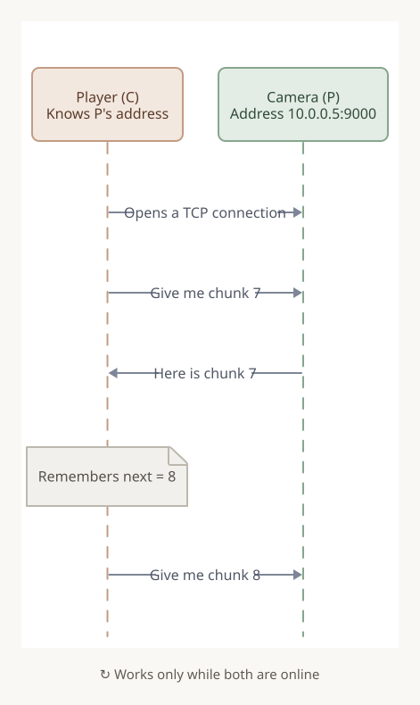
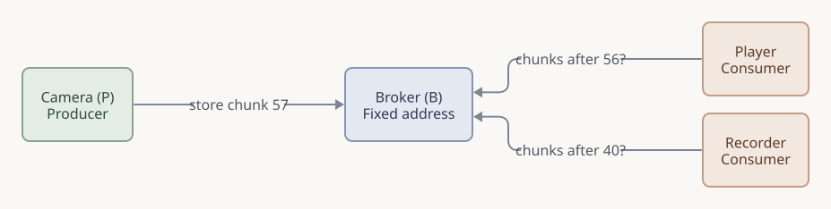
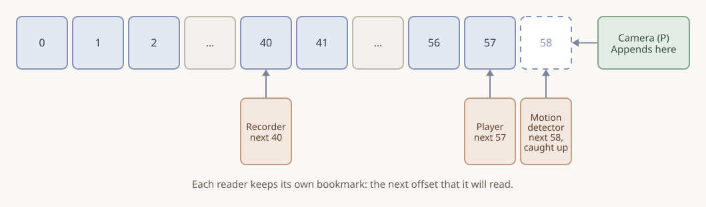
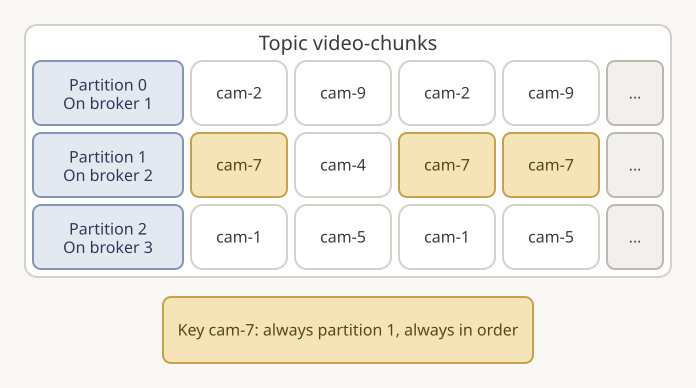
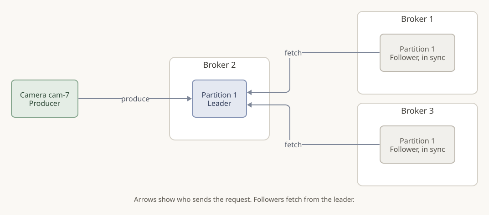
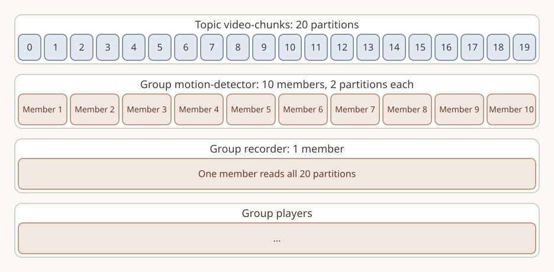
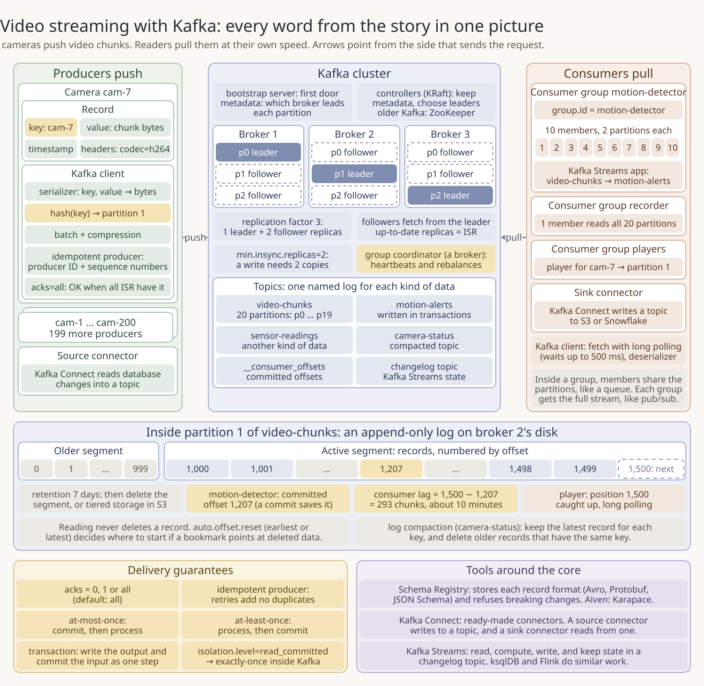

# Apache Kafka {#apache-kafka}

> type: category

## Basics {#basics}

> type: category

### What Is Kafka? {#what-is-kafka}

> type: concept

Apache Kafka is a distributed event-streaming platform for publishing, storing, and processing streams of records. Producers append events to durable, partitioned topics, while consumers read those events independently, making Kafka useful for real-time data pipelines, event-driven services, and streaming analytics.

### How It Works {#how-kafka-works}

> type: concept

Kafka provides a durable, shared event log between systems, so producers and consumers do not need to be online at the same moment and multiple consumers can independently use or replay the same data. In an IoT setup, multiple sensors send measurements over local device protocols to an edge device. A gateway application running on that edge device collects, filters, normalizes, batches, or aggregates the readings, then uses a Kafka client to publish records to a topic such as `sensor-readings`. Kafka brokers append each record to a partition, retain it, and replicate it as configured. An alerting service, time-series database sink, or data-lake loader consumes the topic when ready. Kafka does not automatically choose a destination: that work belongs to a consumer application or Kafka Connect sink. The brokers run centrally as a self-managed or managed cluster, while the edge device and destination only need client or connector software.

#### Core Concepts {#core-concepts}

> type: category

##### Producer {#producer}

> type: concept

An application role that publishes records to Kafka topics. In the IoT example, the gateway is usually the producer and uses a Kafka client library to send sensor readings.

##### Kafka Client {#kafka-client}

> type: concept

A language library or compatible interface used by an application to authenticate with brokers and produce or consume records. It handles Kafka's network protocol and serializes outgoing keys and values or deserializes incoming ones.

##### Kafka Broker {#kafka-broker}

> type: concept

A Kafka server process that receives client requests and stores topic partitions in append-only log-segment files on its storage. Kafka does not require an external database; brokers replicate partition data with other brokers for fault tolerance.

##### Topic {#topic}

> type: concept

A named, durable stream of related records, such as `sensor-readings`. Producers write to the topic and consumers read from it independently.

###### Partition {#partition}

> type: concept

A partition is one ordered, append-only shard of a topic. Every record is written to one partition and receives a sequential offset there; multiple partitions distribute storage and work across brokers, but ordering is guaranteed only within a partition. When a key is present, the producer normally hashes its serialized bytes so the same key goes to the same partition.

###### Retention {#retention}

> type: concept

Retention controls how long or how much of a topic's log Kafka keeps, independently of whether consumers have read it. Time- or size-based retention removes old log segments, while compaction can retain the latest record for each key. Retention defines the replay window; it is not a backup.

##### Cluster {#cluster}

> type: concept

A group of Kafka brokers working together as one service. A cluster spreads topic partitions and their replicas across brokers for capacity and fault tolerance.

###### Replication {#replication}

> type: concept

Replication keeps copies of each partition on different brokers. With replication factor `3`, one leader serves the partition while two followers copy it and an in-sync follower can take over after failure. Replication improves availability and durability, but it multiplies storage and does not replace backup or extend retention.

##### Event {#event}

> type: concept

An event is the meaningful fact that happened, such as sensor `42` measuring `21.4°C`; a record is Kafka's stored representation of that event, and message is an informal term often used for either. A record carries a possibly null key, a value payload, a timestamp, and optional application-defined headers; its topic is selected when produced, and Kafka assigns its partition and offset. The producer serializes the key and value into bytes using JSON, Avro, Protocol Buffers, text, or another agreed encoding, and the consumer deserializes those bytes. The key is application data such as `sensor-42`, not inherently a hash, though the producer commonly hashes its serialized bytes to choose a partition.

##### Consumer {#consumer}

> type: concept

An application role that reads records from topic partitions and processes them. Reading does not delete records; a consumer tracks offsets so it can continue from its last position or intentionally replay earlier data.

##### Sink {#sink}

> type: concept

A consumer application or Kafka Connect sink connector that reads a Kafka topic and writes records to an external destination, such as a time-series database, data lake, or alerting system.

##### Managed Kafka Service {#managed-kafka-service}

> type: concept

A hosted offering that exposes Kafka-compatible cluster endpoints while the provider operates the underlying service. Providers commonly handle compute, storage, networking, broker and controller provisioning, security, monitoring, failed-node replacement, patches, upgrades, scaling, partition rebalancing, and high availability. You still design topics, keys, partitions, retention, schemas, producers, consumers, and business processing; depending on the offering, the data plane may be open-source Apache Kafka or a compatible managed engine.

###### Aiven for Apache Kafka {#aiven-kafka}

> type: concept

Aiven's managed service for Apache Kafka. The Aiven section under Ecosystem & Interfaces explains what Aiven runs, where it runs, and how apps connect.

###### Davra {#davra}

> type: concept

A full industrial IoT platform that bundles and manages Kafka alongside device integration, databases, analytics, digital twins, and application services. Kafka acts as Davra's internal enterprise message bus and IoT data stream, so Davra is broader than a standalone managed Kafka service.

###### Confluent Cloud {#confluent-cloud}

> type: concept

A fully managed data-streaming platform with a cloud-native Apache Kafka engine. Confluent operates cluster provisioning, scaling, reliability, and security and also provides connectors, schema governance, stream processing, and monitoring tools.

###### Amazon MSK {#amazon-msk}

> type: concept

AWS's managed Apache Kafka service. AWS provisions and operates the compute, storage, networking, brokers, maintenance, high availability, and failover while applications use standard Kafka clients.

###### Google Cloud Managed Kafka {#google-managed-kafka}

> type: concept

Google Cloud's managed service for open-source Apache Kafka. It automates broker provisioning, sizing, storage, partition rebalancing, infrastructure maintenance, security integration, monitoring, and logging.

## Let's Invent Kafka from First Principles {#invent-kafka}

> type: procedure

Below, each stage starts with a problem. Then we invent a fix and give it its Kafka name.

**The example.** P is a camera at a site gate. Every 2 seconds it makes one video chunk of about 500 KB: chunk 0, 1, 2, and so on. That is 43,200 chunks a day, about 21.6 GB. C is a video player in an office.

The first Kafka idea is already in this setup: C remembers where it is.

(A note before we start: real video sites send video through CDNs (content delivery networks), not through Kafka. Kafka's default maximum record size is about 1 MB. But the mechanics are the same for any stream of records, so the example still works.)

### Stage 0: P and C talk directly over TCP {#stage-0-direct-tcp}

> type: step
> edge.next: stage-1-machine-in-the-middle



In TCP, one side waits for connections and the other side connects. If C asks in a loop, C connects to P, so **C needs P's address**. If P pushed the chunks, P would need C's address. Either way, one side must know where the other one is.

TCP also numbers its bytes, with sequence numbers. But those numbers exist only inside one connection. The chunk number that C keeps survives a reconnect. That is the start of Kafka's **offset**.

What goes wrong:
1. **Both must be online.** C's laptop sleeps for 10 minutes, and P makes 300 chunks during that time. Either P stores them, or they are lost.
2. **More readers.** The security team adds a recorder, a motion detector and 3 more players. P now serves 5 connections, each at a different position.
3. **Speed.** Suppose P pushes and the motion detector is slow. TCP's buffers fill up, and P's send call waits. A slow reader stops the camera.
4. **Failure.** If P's disk fails, the history is lost with it.

Now P is a camera, a storage server and a delivery service. That is too many jobs for one machine.

### Stage 1: Put a machine in the middle {#stage-1-machine-in-the-middle}

> type: step
> edge.next: stage-2-mailbox

**Invention.** Add one machine B that is always on and has a fixed address. P sends each chunk to B. C asks B for chunks. P and C never talk to each other.



Both arrows point to B, and B never calls P or C. B also does not push chunks to readers. Each reader asks, so each reader controls its own speed. Kafka calls this **pull**.

**Kafka words:** B is a **broker**, and its known address is a **bootstrap server**. P is a **producer**, and C is a **consumer**. The library inside P and C that talks to B is the **Kafka client**.

Next question: how should B keep the chunks?

### Stage 2: The mailbox, the pre-Kafka answer {#stage-2-mailbox}

> type: step
> edge.next: stage-3-numbered-log

**First idea.** Classic message queues, such as RabbitMQ and ActiveMQ, worked like a mailbox. B gives a chunk to a reader, and the reader confirms it (an "ack"). Then B deletes the chunk.

What goes wrong:
- **Two readers.** The player takes chunk 57, so the recorder never gets it. The queue answer is one queue per reader. B puts each chunk into 5 queues and tracks each one.
- **Late reader.** A highlights tool starts at noon and wants the morning's video. Those chunks are already deleted.
- **Bugs.** The motion detector had a bug yesterday. You fix it and want to run it again on yesterday's video. That data is gone.
- **Slow reader.** The recorder's queue grows to a million chunks. B tracks the state of each one and can slow down for everyone.

### Stage 3: Keep everything, in order, and number it {#stage-3-numbered-log}

> type: step
> edge.next: stage-4-cheap-loop

This is the key invention.

**Invention.** B adds each chunk to the end of a file. B never changes a chunk. B also never deletes a chunk because someone read it. Each chunk gets a fixed number, which is its position in the file. Each reader keeps its own bookmark, and B does not track who read what.



**Kafka words:** the file is a **log**. One entry is a **record**, and its number is its **offset**. A reader's bookmark is its **position**.

What this solves:
- One copy serves any number of readers.
- A late reader can start at offset 0.
- To replay, a reader moves its bookmark back.
- A slow reader only falls behind, and no other reader notices.

### Stage 4: Make the loop cheap {#stage-4-cheap-loop}

> type: step
> edge.next: stage-5-disk-fills-up

**Problem 1.** The motion detector is caught up. It asks "anything after 57?" and gets "no", thousands of times per second.

**Invention.** B holds the request open until a new record arrives, or for up to 500 ms by default. Then it answers. This feels like push, but the reader still asks. **Kafka word:** **long polling**.

**Problem 2.** For small records, such as sensor readings, sending one request per record wastes time.

**Invention.** The producer puts many records into one request and often compresses them. The consumer gets many records in one answer. **Kafka words:** **batch**, **compression**.

### Stage 5: The disk fills up {#stage-5-disk-fills-up}

> type: step
> edge.next: stage-6-kinds-of-data

**Problem.** One camera writes 21.6 GB per day, and the log grows forever.

**Invention.** Cut the log into files of, for example, 1 GB each, and keep 7 days of data. When the oldest file is more than 7 days old, delete the whole file. Deleting one file is cheap, and B never deletes single records.

**Kafka words:** each file is a **segment**. The rule for what to keep is **retention**, set by time or by size. The default is 7 days.

**Result.** Suppose a reader is away for longer than retention. Its bookmark then points at deleted data. The `auto.offset.reset` setting decides what it does next. It can start at the oldest record that is still kept (`earliest`) or at the end (`latest`).

Newer Kafka versions can also move old segments to object storage, such as S3. This is **tiered storage**, and it makes long retention cheaper. The Kafka Service node in the Aiven section mentions it too.

### Stage 6: Different kinds of data {#stage-6-kinds-of-data}

> type: step
> edge.next: stage-7-too-much-for-one-machine

**Problem.** B now also stores sensor readings and motion alerts in the same log. To find a few alerts, the alert screen must read through gigabytes of video.

**Invention.** Keep one separate, named log for each kind of data: `video-chunks`, `motion-alerts` and `sensor-readings`. A reader asks for a log by name.

**Kafka word:** **topic**. A topic is a place: each record lives in its topic's log.

### Stage 7: Too much for one machine {#stage-7-too-much-for-one-machine}

> type: step
> edge.next: stage-8-latest-value-matters

**Problem.** Now 200 cameras write to `video-chunks`. That is about 4.3 TB per day. One disk on one broker cannot write or store that much, and one reader cannot process it.

**Invention 1.** Split the topic into many independent logs, and put them on several brokers. Each small log has its own offsets, starting at 0. So the full address of a record is its topic, partition and offset. For example: `video-chunks`, partition 1, offset 1,207.

**Kafka words:** each small log is a **partition**. The group of brokers is a **cluster**.

**New problem: order.** The player for `cam-7` needs cam-7's chunks in order. If those chunks are spread over all partitions, nobody knows their order.

**Invention 2.** Give each record a **key**, the camera ID `cam-7`. The producer hashes the key to choose the partition. So all of cam-7's chunks go to the same partition, in order.



**Rule:** Kafka keeps order only inside one partition. The same key always goes to the same partition, so its records stay in order.

**Small problem.** How does a camera know that broker 2 has partition 1? It asks any broker for a map. The map shows which brokers exist and which broker handles each partition. **Kafka word:** **metadata**. The bootstrap server is only the first door.

Now a record has a clear shape. It has a **key** (`cam-7`), a **value** (the chunk bytes), a **timestamp** and optional **headers** (for example `codec=h264`). Kafka stores only bytes. The producer turns the key and value into bytes with a **serializer**, and the consumer turns them back with a **deserializer**.

### Stage 8: Only the latest value matters {#stage-8-latest-value-matters}

> type: step
> edge.next: stage-9-broker-fails

**Problem.** A `camera-status` topic gets "cam-7 online", "cam-7 offline", "cam-7 online", for years. A new dashboard needs only the current status of each camera. Also, time-based retention would delete the status of a camera that has not changed for 8 days.

**Invention.** For this topic, keep at least the latest record for each key, and delete older records that have the same key. The topic now works like a table, with one row per camera.

**Kafka words:** **log compaction**, and the topic is a **compacted topic**.

### Stage 9: A broker fails {#stage-9-broker-fails}

> type: step
> edge.next: stage-10-reader-too-slow

**Problem.** Broker 2's disk fails. Partition 1 is lost, together with cam-7's history, and cam-7 cannot write.

**Invention.** Keep each partition on 3 brokers. One copy is the **leader**. It takes all writes and, by default, all reads. The other copies are **followers**. A follower copies the leader by asking it for new records, the same way a consumer does. Followers that are fully up to date are **in-sync replicas (ISR)**. If the leader fails, an in-sync follower becomes the new leader.



**The producer's question:** "When is my chunk safe?" The producer chooses a setting called **acks**:
- `acks=0`: do not wait. This is fast, but you can lose data.
- `acks=1`: wait until the leader has the chunk.
- `acks=all`: wait until all in-sync replicas have it. This is the default.

With `min.insync.replicas=2`, at least 2 copies exist before the producer gets "OK".

Who chooses the new leader? A few **controller** nodes keep the cluster's metadata and choose leaders. Kafka 4 uses its built-in **KRaft** protocol for this. Older versions used ZooKeeper.

**Kafka words:** **replication factor** (3 here), **leader**, **follower**, **ISR**, **acks**, **controller**.

### Stage 10: One reader is too slow {#stage-10-reader-too-slow}

> type: step
> edge.next: stage-11-bookmark-storage

**Problem.** The motion detector must check all 200 cameras live. One process can handle 20 cameras, so you run 10 copies. But if each copy reads everything, each chunk gets checked 10 times.

**Invention.** The 10 copies share one name, `motion-detector`. Kafka gives each partition to exactly one copy in that group. With 20 partitions and 10 copies, each copy gets 2 partitions.



**Kafka words:** this is a **consumer group**, and its name is the `group.id`. One broker is the **group coordinator**, and members send it **heartbeats**. When a member fails or a new one joins, the coordinator moves partitions between members. This is a **rebalance**.

Two rules follow from this:
- Inside one group, the members **share** the work, like a queue.
- Different groups each get **the full stream**, like publish/subscribe. The players, the recorder and the motion detector are three separate groups.

Also, with 20 partitions, a group can use at most 20 members, and a 21st member gets nothing. The number of partitions sets the maximum parallel work.

### Stage 11: Where does the bookmark live? {#stage-11-bookmark-storage}

> type: step
> edge.next: stage-12-crashes-and-retries

**Problem.** Copy 4 crashes, and its partitions move to copy 5. Where should copy 5 start? Copy 4 kept the bookmark in its memory, and that memory is gone.

**Invention.** Consumers save their bookmarks in Kafka, in an internal topic called `__consumer_offsets`. Copy 5 reads the last saved bookmark and continues from there.

Note that the bookmarks are themselves a compacted log, with one key for each group, topic and partition. Kafka stores its own state with its own idea.

**Kafka words:** **commit** (save the bookmark) and **committed offset**.

**Consumer lag** comes directly from this. Lag is the last offset in the partition minus the group's committed offset. For example, the log ends at 1,500 and the group committed 1,207. The lag is 293 chunks, which is about 10 minutes of video. In production, lag is the first number to watch.

### Stage 12: Crashes and retries {#stage-12-crashes-and-retries}

> type: step
> edge.next: stage-13-tools-around-the-core

**Problem A, on the consumer side.** Copy 4 processed chunks 1,207 to 1,300, then crashed before it committed. Copy 5 starts again at 1,207, so those chunks get processed twice.
- If you commit after processing, duplicates can occur. This is **at-least-once**.
- If you commit before processing, you can lose data. This is **at-most-once**.

**Problem B, on the producer side.** The camera sends chunk 57, and the leader stores it. But the "OK" is lost on the network, so the camera sends the chunk again. Now chunk 57 is in the log twice.
- **Invention:** each producer gets an ID and numbers its batches. The broker drops any batch that it already has. This is the **idempotent producer**, and it is on by default.

**Problem C, read-process-write.** The motion detector reads chunks and writes alerts to `motion-alerts`. After a crash, it can write the same alert twice.
- **Invention:** write the alerts and commit the input bookmark as one all-or-nothing step. This is a **transaction**. Readers with `isolation.level=read_committed` see only finished transactions. Together, these give you **exactly-once** processing inside Kafka.

### Stage 13: The tools around the core {#stage-13-tools-around-the-core}

> type: step

You do not need these for the core idea, but you will see them:
- **Schema Registry.** Kafka stores only bytes. If the camera team changes the record format, the recorder breaks. A Schema Registry stores each version of the format (Avro, Protobuf or JSON Schema). It refuses a new version that would break readers. It is a separate service, not part of Apache Kafka, and Aiven's version is Karapace.
- **Kafka Connect.** Many teams write the same "topic to S3" or "database to topic" program. Kafka Connect runs ready-made connectors instead. A **source connector** is a producer, for example one that reads database changes. A **sink connector** is a consumer, for example one that writes to S3 or Snowflake.
- **Kafka Streams.** The motion detector follows a common pattern: read a topic, compute, write a topic, and keep some state. Kafka Streams is a library for this pattern. It backs up its state to a compacted **changelog topic**, so a new instance can rebuild the state by replaying that topic. ksqlDB and Apache Flink do similar work.

### The whole story in one picture {#whole-story-picture}

> type: concept



### The whole story in one table {#whole-story-table}

> type: concept

| Problem | Invention | Kafka word |
|---|---|---|
| P and C must be online together and know each other | A machine in the middle with a known address | broker, bootstrap server |
| If B pushes, a slow reader gets too much data | Readers ask at their own speed | pull |
| Reading deletes the data | Append-only file, numbered entries, a bookmark for each reader | log, record, offset |
| Caught-up readers ask in a busy loop | Hold the request until data arrives | long polling |
| The disk fills up | Cut the log into files and delete old files | segment, retention |
| Different kinds of data are mixed | One named log for each kind | topic |
| Too much data for one machine | Many logs per topic, on many brokers | partition, cluster |
| No order across partitions | Same key, same partition | key |
| Only the latest value matters | Keep the latest record for each key | compaction |
| A broker fails | Copies on other brokers | replica, leader, follower, ISR, acks, controller |
| One reader is too slow | Share partitions between copies of the reader | consumer group, rebalance |
| Bookmarks are lost when a process crashes | Save bookmarks in Kafka | commit, `__consumer_offsets`, lag |
| Retries and crashes cause duplicates | Producer IDs, sequence numbers, all-or-nothing writes | idempotent producer, transactions |

Last step: change "video chunk" to "sensor reading" and "camera" to "gateway". Then you have the IoT setup that the Basics and Data Flow sections describe.

## Runtime Model {#runtime-model}

> type: category

Kafka is not one infinite loop searching external systems for messages. It is a collection of long-running broker server processes and client applications communicating over persistent TCP connections: producers push records to brokers, consumers pull records from brokers, and brokers store the records between them.

### Producer Application {#producer-application}

> type: concept

In the IoT example, the gateway application typically runs a loop that waits for sensor readings. When data arrives, it builds a record and asks its Kafka client to serialize, batch, and push the record to a broker; Kafka itself does not inspect the sensors.

#### Bootstrap & Metadata {#producer-bootstrap-metadata}

> type: concept

The client starts with one or more bootstrap addresses such as `kafka-1.example.com:9092`. It resolves a hostname to an IP address, opens a TCP connection, and requests cluster metadata to learn which brokers exist and which broker leads each topic partition; the bootstrap broker is an entry point, not a permanent proxy.

#### Persistent Connections {#producer-persistent-connections}

> type: concept

The client maintains and reuses TCP connections to the brokers it needs instead of opening a new connection for every record. Connections may cross a private network, VPN, or the internet and commonly use TLS encryption plus authentication; the client handles reconnecting and retrying when connections fail.

#### Produce Request {#producer-produce-request}

> type: concept

Calling `producer.send(record)` makes the client serialize and batch records into Kafka's binary produce-request format, then send the bytes through a TCP connection to the partition's leader broker. TCP divides the request into IP packets for network transport, and the broker returns an acknowledgement according to the producer's configuration.

### Broker Process {#broker-process}

> type: concept

A broker is a long-running Kafka server process, commonly run as an operating-system service, container, or Kubernetes workload. At startup it loads its partition logs, joins the cluster, opens configured TCP listeners—commonly on port `9092`—and waits efficiently for client and broker requests. A managed Kafka provider runs these broker processes for you.

#### Request Handling {#broker-request-handling}

> type: concept

Network I/O and request-handler loops wait on sockets rather than repeatedly scanning for data. A produce request is validated and appended to a partition log; a fetch request asks for records after an offset and may be held briefly until data arrives, avoiding a wasteful busy loop.

#### Background Work {#broker-background-work}

> type: concept

Kafka continuously performs internal maintenance alongside client requests. Followers fetch partition updates from leaders, retention removes expired log segments, compaction and log maintenance manage storage, and cluster coordination tracks metadata and broker leadership.

### Consumer Application {#consumer-application}

> type: concept

A consumer application typically runs a poll loop that asks Kafka for records after its current partition offsets. Kafka may hold an empty fetch request open briefly, then returns new records or a timeout; the consumer deserializes and processes the results. Kafka does not push records to the destination, and reading them does not delete them.

## Data Flow {#data-flow}

> type: procedure

### Sensor Measures {#sensor-measures}

> type: step
> edge.next: edge-device-collects

One or more sensors measure properties in the physical world, such as sensor `42` recording a temperature of `21.4°C`, and emit their own streams of readings.

### Edge Device Collects {#edge-device-collects}

> type: step
> edge.next: gateway-builds-event

The edge device is a local computing device—such as an industrial PC, PLC, embedded controller, or gateway appliance—that receives streams from multiple sensors. It may filter, normalize, batch, aggregate, or temporarily buffer readings before they move upstream.

### Gateway Builds Event {#gateway-builds-event}

> type: step
> edge.next: client-creates-record

The gateway application is software running on the edge device. It converts selected sensor data into application events containing information such as the sensor ID, measured value, unit, and measurement time, and decides what should be published to Kafka.

### Client Creates Record {#client-creates-record}

> type: step
> edge.next: client-serializes-sends

The Kafka client is a library used by the gateway application to communicate with Kafka. Acting as a producer, the gateway uses it to create a record with the destination topic, key, value, timestamp, and any optional headers.

### Client Serializes & Sends {#client-serializes-sends}

> type: step
> edge.next: broker-appends-record

The client serializes the key and value into bytes, chooses a partition—normally using the key—and finds its leader through cluster metadata. It reuses a persistent TCP connection, or opens one when needed, and sends a binary Kafka produce request; DNS, IP routing, optional TLS and authentication, packet transport, retries, and acknowledgements are handled underneath.

### Broker Appends Record {#broker-appends-record}

> type: step
> edge.next: kafka-replicates-retains

The leader broker appends the record to the partition log on disk and assigns its sequential offset within that partition.

### Kafka Replicates & Retains {#kafka-replicates-retains}

> type: step
> edge.next: consumer-reads-record

Follower brokers copy the partition data according to its replication factor, and Kafka keeps the record according to the topic's retention policy.

### Consumer Reads Record {#consumer-reads-record}

> type: step
> edge.next: application-uses-event

A consumer fetches records from its current partition offset and uses its Kafka client to deserialize the key and value back into application data.

### Application Uses Event {#application-uses-event}

> type: step

The consumer can trigger an alert, perform a calculation, or use a sink to write the data to another system. Reading advances the consumer's position but does not delete the Kafka record; retention still controls when Kafka removes it.

## Architecture {#architecture}

> type: category

## Reliability & Operations {#reliability-and-operations}

> type: category

## Use Cases {#use-cases}

> type: category

## Ecosystem & Interfaces {#ecosystem-and-interfaces}

> type: category

### Kafka Connect {#kafka-connect}

> type: concept
> edge.related: sink, stage-13-tools-around-the-core

Kafka Connect is the part of Apache Kafka that moves data between Kafka and other systems ([Kafka Connect overview](https://kafka.apache.org/44/kafka-connect/overview/)). You configure a ready-made connector, and Kafka Connect runs it. This replaces a custom producer or consumer program for each outside system.

Kafka Connect runs as its own processes, called workers. The workers are separate from the brokers. Each worker uses a normal Kafka client to read and write topics. Apache Kafka ships the framework. Most connector plugins come from other projects, for example Debezium for databases and Snowflake for Snowflake.

A record passes through Kafka Connect in a fixed order:

- Source: outside system → source task → transforms → converter → Kafka topic
- Sink: Kafka topic → converter → transforms → sink task → outside system

The child nodes explain each part:

- A connector is a plugin plus a configuration for one outside system.
- A Connect cluster is the group of workers that runs the connectors' tasks.
- A converter turns records into bytes and back, and a transform changes one record at a time.
- The example loads the `sensor-readings` topic into Snowflake.

#### Connector {#connect-connector}

> type: concept

A connector is a plugin plus a configuration. The plugin is a Java library that knows one outside system. The configuration says which plugin to use, which topics to read or write, and how to reach the outside system. Each worker loads plugins from the folders in its `plugin.path` setting.

There are two kinds of connector:

- A source connector reads an outside system and writes records to Kafka, like a producer. For example, the [Debezium PostgreSQL connector](https://debezium.io/documentation/reference/stable/connectors/postgresql.html) reads the database's change log. It writes the changes of each table to one topic, named topicPrefix.schemaName.tableName, for example `pg.public.equipment`.
- A sink connector reads Kafka topics and writes the records to an outside system, like a consumer. For example, the Snowflake connector writes records into Snowflake tables.

Every connector configuration has these keys ([Kafka Connect user guide](https://kafka.apache.org/44/kafka-connect/user-guide/)):

- `name`: a unique name for the connector.
- `connector.class`: the plugin's Java class.
- `tasks.max`: the highest number of tasks. The connector can start fewer tasks.
- `topics`: for a sink, the topics to read.
- `key.converter` and `value.converter`: the formats of keys and values in Kafka. Each one overrides the worker's default.

#### Connect Cluster {#connect-cluster}

> type: concept
> edge.related: stage-11-bookmark-storage

A Connect cluster is a group of workers that share the work of the connectors. A worker is one Java process. Kafka Connect has two modes ([Kafka Connect user guide](https://kafka.apache.org/44/kafka-connect/user-guide/)):

- Standalone mode runs one worker. The worker keeps the source offsets in a local file. This mode suits one small job, such as reading one log file.
- Distributed mode runs many workers with the same `group.id`. They keep their shared state in three compacted Kafka topics: the connector configurations, the source offsets and the statuses. If a worker stops, the other workers take over its tasks.

A task is a unit of work that copies data. A connector splits its job into at most `tasks.max` tasks, and the cluster spreads the tasks across the workers.

A source offset is a source connector's position in the outside system, such as a place in the database's change log. A sink connector keeps its position as a normal consumer group. Its tasks form one group, named `connect-` plus the connector name. Kafka shares the topic's partitions among the tasks and keeps their committed offsets in `__consumer_offsets`.

You manage a Connect cluster through its REST API. Every worker serves it, on port 8083 by default. `POST /connectors` creates a connector from a JSON object with a `name` and a `config`. `GET /connectors/{name}/status` shows the state of the connector and of each task. By default, anyone who can reach the REST API can start and stop connectors. Give access to it only to trusted users.

#### Converter and Transform {#connect-converter-transform}

> type: concept
> edge.related: karapace

Kafka stores only bytes. Inside Kafka Connect, a record has typed fields. A converter translates between the two. It turns a record into bytes on the way into Kafka. It turns bytes into a record on the way out. Because the converter is separate from the connector, any connector can use any format. Common converters:

- `StringConverter` reads and writes plain text.
- `JsonConverter` reads and writes JSON text.
- `AvroConverter` reads and writes compact Avro bytes. It keeps each schema in a Schema Registry, and each message carries only the schema ID. The Karapace node explains the Schema Registry.

A transform, or single message transform (SMT), changes one record as it passes through a connector. It can add, remove or rename a field, or send the record to another topic. A connector lists its transforms, in order, in the `transforms` key. In a source connector, the transforms run before the converter. In a sink connector, they run after it.

#### Example: Topic to Snowflake {#connect-snowflake-example}

> type: concept

This example loads the `sensor-readings` topic of the IoT setup into Snowflake. The topic has 3 partitions. Each value is JSON text, such as `{"sensor_id": 42, "temperature_c": 21.4}`. The sink uses version 4 of the [Snowflake connector for Kafka](https://docs.snowflake.com/en/user-guide/kafka-connector/setup-kafka). A `POST /connectors` request with this body creates it:

```json
{
  "name": "sensor-readings-to-snowflake",
  "config": {
    "connector.class": "com.snowflake.kafka.connector.SnowflakeStreamingSinkConnector",
    "tasks.max": "3",
    "topics": "sensor-readings",
    "snowflake.topic2table.map": "sensor-readings:SENSOR_READINGS",
    "snowflake.url.name": "https://myorg-myaccount.snowflakecomputing.com",
    "snowflake.user.name": "KAFKA_LOADER",
    "snowflake.private.key": "<private key>",
    "snowflake.role.name": "KAFKA_LOADER_ROLE",
    "snowflake.database.name": "IOT",
    "snowflake.schema.name": "RAW",
    "key.converter": "org.apache.kafka.connect.storage.StringConverter",
    "value.converter": "org.apache.kafka.connect.json.JsonConverter",
    "value.converter.schemas.enable": "false",
    "snowflake.streaming.validate.compatibility.with.classic": "false"
  }
}
```

Then this happens:

1. Kafka Connect starts 3 tasks. They join the consumer group `connect-sensor-readings-to-snowflake`, and each task reads 1 partition.
2. Each task turns the JSON bytes into a record with the `JsonConverter`.
3. The task sends the records through Snowpipe Streaming, Snowflake's API that writes rows straight into tables.
4. If the table `IOT.RAW.SENSOR_READINGS` is missing, the connector creates it. Each JSON field becomes a column, so the reading above becomes a row with 42 in `sensor_id` and 21.4 in `temperature_c`.

Two other setups load the same topic:

- With `snowflake.autocreate.table.type` set to `iceberg`, the connector creates a Snowflake-managed Apache Iceberg table instead.
- The Apache Iceberg sink connector writes Iceberg tables to S3, and Snowflake reads them in place. The [Kafka → Iceberg → Snowflake map](../integration/kafka-iceberg-snowflake/kafka-iceberg-snowflake.md) explains this setup.

### Aiven {#aiven}

> type: concept
> edge.related: managed-kafka-service, aiven-kafka

Aiven is a company that runs open-source data services for you in the cloud ([Get started with Aiven](https://aiven.io/docs/get-started)). Its services include Apache Kafka, Kafka Connect, PostgreSQL and OpenSearch.

Each Aiven service is a managed service, as the Managed Kafka Service node describes. Aiven creates the machines, installs the open-source software, and keeps it patched and running. You get a host name, a port and credentials, and you use the software through its normal interface. For Kafka, that interface is the Kafka protocol, so your apps keep their normal Kafka client.

Where Aiven sits is easiest to see as four layers, from the bottom up:

1. A cloud provider, such as AWS, Google Cloud or Azure, supplies the machines, disks and networks.
2. Aiven creates services on those machines and operates them.
3. The services run the open-source software: Kafka brokers, Kafka Connect workers and Karapace.
4. You build on the services. You create topics, schemas and connectors, and your apps produce and consume records.


You control Aiven with one of these tools. All of them change the same projects and services:

- The Aiven Console, a web app.
- The `avn` command-line tool.
- The Aiven API.
- The Aiven provider for Terraform. The [Terraform map](../terraform/terraform.md) shows it in use.
- The Aiven Operator for Kubernetes.

Snowflake offers the same deal for its own database: you pick a cloud and a region, and Snowflake runs the machines. Aiven offers this deal for open-source software.

#### Projects and Services {#aiven-projects-services}

> type: concept

Aiven groups everything in three levels ([organizations, units and projects](https://aiven.io/docs/platform/concepts/orgs-units-projects)):

- An organization holds all your projects, users and billing. Inside it, organizational units can group projects, for example by department. Units are optional.
- A project holds a group of services. Teams often make one project per environment, such as `dev` and `prod`. Access rights and network settings apply to all services in a project.
- A service is one running product, such as one Kafka cluster or one Kafka Connect cluster. When you create a service, you choose its cloud provider, region and plan. The plan sets the size of the service and its price. The service name is fixed after you create the service.

To scale a service up or down, you change its plan ([scale services](https://aiven.io/docs/platform/howto/scale-services)). The Aiven Console shows each service's CPU, memory, disk and network use on its Metrics tab ([service integrations](https://aiven.io/docs/platform/concepts/service-integration)).

For example, the project `iot-prod` holds the Kafka service `kafka-iot` and the Kafka Connect service `connect-iot`. Inside the Kafka service, you create topics, service users and access rules. The [Aiven provider for Terraform](https://registry.terraform.io/providers/aiven/aiven/latest/docs) has one resource for each of these objects: `aiven_kafka`, `aiven_kafka_connect`, `aiven_kafka_topic`, `aiven_kafka_user`, `aiven_kafka_acl` and `aiven_kafka_connector`.

#### Where Services Run {#aiven-where-services-run}

> type: concept

An Aiven service runs on the machines of a cloud provider, in the region that you choose. The machines can be in one of two places ([bring your own cloud](https://aiven.io/docs/platform/concepts/byoc)):

- Aiven Cloud is the usual option. The machines are in cloud accounts that Aiven owns. Aiven also manages the storage, the backups and the security setup.
- With bring your own cloud (BYOC), Aiven creates a custom cloud inside your AWS, Google Cloud or Azure account. Aiven runs the services there. The data stays in your account, and your cloud discounts apply to the machines. BYOC needs a commitment deal with Aiven and the Advanced or Premium support tier.

In both cases, Aiven operates the services. Your apps reach a service through its host name and port. A project can also have its own virtual private cloud (VPC). You can peer the VPC with your cloud network for private connections ([VPC peering](https://aiven.io/docs/platform/howto/list-vpc-peering)).

#### Kafka Service {#aiven-kafka-service}

> type: concept
> edge.related: stage-5-disk-fills-up

Aiven's Kafka product is Aiven for Apache Kafka ([overview](https://aiven.io/docs/products/kafka)). It runs Apache Kafka, so every Kafka client works with it. You choose one of two service types when you create the service, and the type is fixed after that:

- Standard Kafka is the type for new customers. It runs Kafka 4 with KRaft, on Aiven Cloud only. Its classic topics keep only recent data on the broker disks, 15 minutes or 5 GB per partition. Tiered storage moves the older segments to object storage. Its diskless topics keep all their data in object storage. Aiven bills compute, storage and network use separately ([Standard Kafka](https://aiven.io/docs/products/kafka/standard-kafka-overview)).
- Classic Kafka is the earlier type, for existing customers and for the Free and Developer tiers. A fixed plan sets the brokers' compute, memory and local disk. Tiered storage is optional, and Classic Kafka can run in BYOC ([Classic Kafka](https://aiven.io/docs/products/kafka/classic-kafka-overview)).

Aiven for Apache Kafka MirrorMaker 2 copies topics from one Kafka service to another, for example to another region, or from a Classic to a Standard service.

#### Connecting Clients {#aiven-connecting-clients}

> type: concept
> edge.related: kafka-client

An app connects to an Aiven Kafka service as to any Kafka cluster. It puts the service's host name and port into its `bootstrap.servers` setting. Every connection uses TLS encryption ([authentication types](https://aiven.io/docs/products/kafka/concepts/auth-types)).

The app signs in as a service user, a Kafka identity that belongs to one Kafka service. There are two sign-in methods:

- SASL, with a user name and a password. New services turn SASL on by default, and Aiven recommends the SCRAM-SHA-256 mechanism ([connect with Python](https://aiven.io/docs/products/kafka/howto/connect-with-python)).
- A client certificate, also called mutual TLS. The app shows an access key and an access certificate from Aiven. The Aiven Console offers them as the files `service.key` and `service.cert` ([keystore and truststore](https://aiven.io/docs/products/kafka/howto/keystore-truststore)).

The app also trusts the project's CA certificate, the file `ca.pem`, which signs the broker certificates. Access control lists (ACLs) then decide what each service user may do, for example read the topics that start with `sensor-` ([ACLs](https://aiven.io/docs/products/kafka/concepts/acl)). A new service has the user `avnadmin`, with admin rights on all topics.

#### Kafka Connect Service {#aiven-kafka-connect}

> type: concept
> edge.related: kafka-connect

Aiven for Apache Kafka Connect is a Connect cluster in distributed mode that Aiven runs for you ([Aiven for Apache Kafka Connect](https://aiven.io/docs/products/kafka/kafka-connect)). Aiven operates the workers, and you create the connectors. The workers run in one of three places:

- On the nodes of the Kafka service. This is the low-cost way to start. It needs a Classic Kafka service on a business or premium plan, and the workers share CPU and memory with the brokers ([enable Kafka Connect](https://aiven.io/docs/products/kafka/kafka-connect/howto/enable-connect)).
- In a dedicated Kafka Connect service, which a service integration joins to the Kafka service. It has its own CPU and memory and scales on its own. Standard Kafka needs this setup ([get started](https://aiven.io/docs/products/kafka/kafka-connect/get-started)).
- In your own Connect cluster, which connects to the Aiven Kafka service like any other client ([bring your own Connect cluster](https://aiven.io/docs/products/kafka/kafka-connect/howto/bring-your-own-kafka-connect-cluster)). For example, a change data capture (CDC) source connector reads a database's change log. It can run on a server inside the database's network, and connect out to Aiven over TLS. The [Kafka → Iceberg → Snowflake map](../integration/kafka-iceberg-snowflake/kafka-iceberg-snowflake.md) shows this setup.

Aiven supplies many connector plugins ([available connectors](https://aiven.io/docs/products/kafka/kafka-connect/concepts/list-of-connector-plugins)). Examples are Debezium for databases, JDBC, Amazon S3, the Apache Iceberg sink and the Snowflake sink. You can also upload your own plugins. You create a connector in the Aiven Console, with the command `avn service connector create <service> @config.json`, or with the Terraform resource `aiven_kafka_connector`. All three take the configuration as one flat set of keys, with `name` next to the others ([Snowflake sink on Aiven](https://aiven.io/docs/products/kafka/kafka-connect/howto/snowflake-sink)).

#### Karapace {#karapace}

> type: concept

Karapace is Aiven's open-source Schema Registry and REST proxy ([Karapace](https://aiven.io/docs/products/kafka/karapace)). It runs with the Aiven Kafka service, on the service's host name with its own port. You turn on each part separately.

- A Schema Registry stores the schema of each topic's keys and values, in versions. A schema lists the fields and their types. Producers and consumers fetch schemas from it to serialize and deserialize records. The registry checks each new version against the older ones and refuses a version that would break readers. Karapace supports Avro, Protobuf and JSON Schema. Its API matches the API of Confluent's Schema Registry, so clients and converters for Confluent's registry work with it ([Karapace README](https://github.com/Aiven-Open/karapace)).
- The REST proxy lets a program produce and consume records over HTTP, for example with `curl`.
