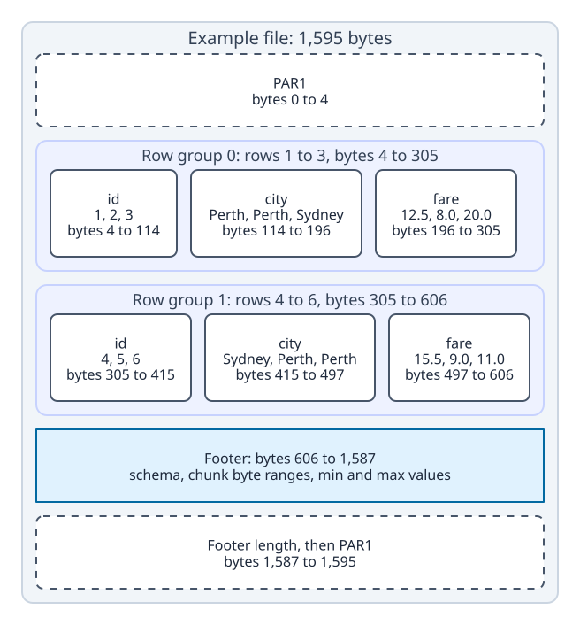

# Apache Parquet {#apache-parquet}

> type: category

What is a Parquet file, and why does it store each column together? [Apache Parquet](https://parquet.apache.org/) is a file format for the rows and columns of one table. It stores the values of each column next to each other, not row by row. The file also holds the column names and types. [Apache Iceberg](../iceberg/iceberg.md) uses it as its usual data file format. Snowflake supports Iceberg tables that use Parquet files ([Snowflake documentation](https://docs.snowflake.com/en/user-guide/tables-iceberg)).

Keeping a column together gives three gains. A reader loads only the columns that a query needs. The writer stores each column in a compact form. A reader skips whole blocks of rows, by using the minimum and maximum values in the footer. How Much Columnar Saves measures the gains. The price is that one row is spread over every column. An engine, which is a program that runs queries such as Snowflake, also writes each Parquet file once and replaces it to change data. Files Are Written Once explains why.

## Basics {#parquet-basics}

> type: category

### What Is Parquet? {#what-is-parquet}

> type: concept

A Parquet file stores the data of one table: named, typed columns and many rows. This map follows one example table with the columns `id`, `city`, and `fare`, and six rows: `1, Perth, 12.5`; `2, Perth, 8.0`; `3, Sydney, 20.0`; `4, Sydney, 15.5`; `5, Perth, 9.0`; and `6, Perth, 11.0`. A short script writes the table to the file `trips.parquet`, which takes 1,595 bytes. The file is stored beside this map, and About the Numbers shows the script. The file also stores the type of each column: `id` is an integer (`int64`), `city` is text (`string`), and `fare` is a decimal number (`double`). The file stores each value as the bytes of its number or text. With plain encoding, which writes each value as it is, the number 12.5 is the 8 bytes `00 00 00 00 00 00 29 40`. The writer of `trips.parquet` also compresses the bytes with SNAPPY, a compression method, so the file holds their compressed form (Compress the Bytes explains it). A CSV file stores the same number as the four characters `12.5`, which are the bytes `31 32 2e 35`. A tool that reads Parquet decodes the bytes into rows and columns.

### Why Parquet Exists {#why-parquet-exists}

> type: concept

The [specification](https://github.com/apache/parquet-format/blob/ec90dd4/README.md#L34-L43) states four goals:

- A compressed, efficient columnar representation of data.
- Very efficient compression and encoding, chosen for each column.
- Support for complex nested data structures.
- One format that every data processing framework can use.

The first two goals are about cost: fewer bytes to store and fewer bytes to read. [How Much Columnar Saves](#how-much-columnar-saves) measures them. The other two goals are about what a file can hold and who can read it.

### Row Layout {#row-layout}

> type: concept

A row layout stores one record after another. A CSV (comma-separated values) file is the usual example. The example table becomes six text lines: `1,Perth,12.5`, then `2,Perth,8.0`, then `3,Sydney,20.0`, and so on. The three values of one record sit next to each other. To read only `fare`, a reader must scan every line and cut out the third value.

### Column Layout {#column-layout}

> type: concept

> edge.contrasts: row-layout
> edge.related: row-group

A column layout stores all values of one column together. A Python dictionary shows the idea. Each key is a column, and each value is the list of that column's values. [pyarrow](https://arrow.apache.org/docs/python/generated/pyarrow.Table.html#pyarrow.Table.to_pydict) is the Python library for Apache Arrow. Its `to_pydict()` method returns the example table as `{'id': [1, 2, 3, 4, 5, 6], 'city': ['Perth', 'Perth', 'Sydney', 'Sydney', 'Perth', 'Perth'], 'fare': [12.5, 8.0, 20.0, 15.5, 9.0, 11.0]}`. A Parquet file adds one detail. It cuts each list into pieces, one for each row group.

### Many Files Form One Table {#many-files-form-one-table}

> type: concept

A large table is usually many Parquet files. Each file has its own footer, which describes only that file. A table format such as Apache Iceberg records which files form the table. A Snowflake Iceberg table is an example. Its rows sit in many Parquet files in cloud storage, and the Iceberg metadata names the files. The [Iceberg map](../iceberg/iceberg.md) explains the table format, and the [Iceberg in Snowflake map](../snowflake/iceberg/snowflake-iceberg.md) covers Snowflake's side.

## File Anatomy {#file-anatomy}

> type: category

A Parquet file is a stack of parts. At the top level, the file holds row groups and a footer. A row group holds one column chunk for each column. A column chunk holds pages. The picture shows the example file down to the column chunks, with the real byte range of each part. The [format specification](https://github.com/apache/parquet-format/blob/ec90dd4/README.md#L64-L85) defines the same hierarchy.



### Magic Bytes {#magic-bytes}

> type: concept

Every Parquet file starts and ends with the four bytes `PAR1`. A reader checks them to know that the file is Parquet. The next bytes start the header of the first page. In the example file, the first 11 bytes are `b'PAR1\x15\x04\x150\x15.L'` in Python notation. The bytes `0x15` and `0x04` are control codes, which an editor does not show as letters. The [specification](https://github.com/apache/parquet-format/blob/ec90dd4/README.md#L92-L121) shows the layout.

### Row Group {#row-group}

> type: concept

A row group is a slice of consecutive rows. The example file has two: rows 1 to 3, and rows 4 to 6. Read back with pyarrow, each column shows as two pieces, one for each row group: `id: [[1,2,3],[4,5,6]]`. A row group holds one column chunk for each column. The [specification](https://github.com/apache/parquet-format/blob/ec90dd4/README.md#L251-L257) recommends large row groups, from 512 MB to 1 GB. Large row groups allow large sequential reads, but the writer needs more memory. The example uses three rows per group only to keep the picture small.

#### Column Chunk {#column-chunk}

> type: concept

A column chunk holds the values of one column inside one row group, in one contiguous byte range. In the example file, the `id` chunk of row group 0 covers bytes 4 to 114. The `city` chunk follows it at bytes 114 to 196. The [specification](https://github.com/apache/parquet-format/blob/ec90dd4/README.md#L87-L90) names the column chunk as the unit for input and output.

##### Page {#page}

> type: concept

A column chunk is a run of pages. A page is the smallest unit that the writer encodes and compresses ([glossary](https://github.com/apache/parquet-format/blob/ec90dd4/README.md#L79-L81)). A reader can skip pages that it does not need. When a chunk uses dictionary encoding, its first page is the dictionary page. The data pages follow ([specification](https://github.com/apache/parquet-format/blob/ec90dd4/README.md#L207-L218)). In the example file, the `id` chunk of row group 0 has a dictionary page at byte 4 and a data page at byte 41.

### Footer {#footer}

> type: concept

The footer is the last part of the file. After it come its length (4 bytes) and the closing `PAR1` (4 bytes). In the example file, the footer covers bytes 606 to 1,587. The footer holds three things:

- The schema, which lists the column names and types ([file metadata](https://github.com/apache/parquet-format/blob/ec90dd4/src/main/thrift/parquet.thrift#L1422-L1445)).
- The byte range, codec, and encodings of every column chunk ([column metadata](https://github.com/apache/parquet-format/blob/ec90dd4/src/main/thrift/parquet.thrift#L922-L959)).
- The minimum and maximum value of every column chunk.

A reader starts here. It reads the end of the file, finds the footer length, and then reads the footer. The writer puts the footer last, so that it can write the file in one pass ([specification](https://github.com/apache/parquet-format/blob/ec90dd4/README.md#L109-L121)).

## Why Columnar Pays {#why-columnar-pays}

> type: category

A query costs the bytes it reads and the values it decodes. A row layout keeps the fields of one row together, so a query that needs one column still reads every field. A column layout keeps the values of one column together, so a reader fetches only the columns that it needs.

### How Much Columnar Saves {#how-much-columnar-saves}

> type: concept

The measurements use one table of 300,000 rows with the columns `id`, `city`, `fare`, and `note`. The table is stored three ways. CSV is a row layout in a text file. SQLite is a row layout in a database file, with `id` as the primary key. Parquet is the column layout. The three nodes below hold the numbers. About the Numbers describes the files and the method.

#### Three Queries on One Table {#three-queries}

> type: concept

The times are the median of 5 runs on one thread, with the files in the operating system cache. They show CPU work and no disk delay. The byte counts are exact.

- Sum of `fare` where `city` is `Perth`. This needs 2 of the 4 columns. Parquet reads 705,192 bytes and takes 4.5 ms. SQLite takes 12 ms. CSV reads 19,625,110 bytes and takes 23 ms.
- Sum of `fare` where `id` is at least 200000. This needs 2 columns from 1 of the 3 row groups. Parquet reads 866,416 bytes and takes 0.6 ms. SQLite takes 2.7 ms. CSV reads 19,625,110 bytes and takes 21 ms.
- Read every column of every row. Parquet reads 15,416,992 bytes and takes 9.8 ms. CSV reads 19,625,110 bytes and takes 25 ms.

In the first query, Parquet reads 28 times fewer bytes than CSV. Two steps make the gap. The CSV text of `city` and `fare` alone takes 4,736,208 bytes, which is 4.1 times fewer than the whole file. Parquet stores those two columns in 639,656 bytes, and the footer read adds 65,536 bytes. Column Pruning, Encoding and Compression, and Row Group Skipping explain the steps. In the third query, Parquet is still 2.6 times faster.

#### Savings Grow With Table Width {#savings-grow-with-width}

> type: concept

The gain depends on how many columns a query skips. Each table here has 100,000 rows of random decimal numbers, and each query sums the first column. Parquet reads the same 334,234 bytes for every table, because the other columns are skipped.

- 4 columns: the CSV file has 2,312,335 bytes, which is 6.9 times more than Parquet reads. Parquet takes 0.2 ms and CSV takes 4.2 ms.
- 20 columns: the CSV file has 11,561,921 bytes, which is 35 times more. Parquet takes 0.3 ms and CSV takes 17 ms.
- 100 columns: the CSV file has 57,805,429 bytes, which is 173 times more. Parquet takes 0.4 ms and CSV takes 85 ms.

A wide table with a narrow query gains the most. Snowflake tables also store columns separately, so a Snowflake query scans only the columns that it references (see Column Pruning).

#### Savings Depend on Column Values {#savings-depend-on-values}

> type: concept

> edge.related: encoding-and-compression

Parquet is efficient with compression for three reasons. The writer encodes each column by its type before the codec runs. The writer picks the encoding and the codec for each column, and the footer records both. A reader decompresses only the pages of the columns that a query needs.

The sizes below are rough. They come from the test table with ZSTD as the codec. Each one compares a Parquet column with the CSV text of the same column, compressed with ZSTD too:

- Four different city names: about 4 times smaller. Dictionary encoding does this.
- Ids that rise by one: thousands of times smaller. Delta encoding stores only the step between neighbours, which is always 1.
- Decimal fares: about 1.3 times smaller.
- Random letters: about the same size. Only the codec can shrink them, by about a third with ZSTD and a few percent with SNAPPY.

With ZSTD, the whole table is about half its CSV size, in Parquet and in CSV alike. Parquet is only a few percent smaller than the compressed CSV, because two thirds of the table is random letters. A query on one column decompresses about 20 times fewer bytes than a compressed CSV file needs, and it runs about 30 times faster.

Snowflake compresses each column of a micro-partition on its own and picks the algorithm itself ([micro-partitions](https://docs.snowflake.com/en/user-guide/tables-clustering-micropartitions)). Iceberg writes Parquet files with ZSTD unless the table property `write.parquet.compression-codec` says otherwise ([configuration](https://iceberg.apache.org/docs/latest/configuration/)).

### Column Pruning {#column-pruning}

> type: concept

> edge.related: footer

A reader fetches only the column chunks that a query needs. It finds their byte ranges in the footer and skips the rest. The test file `trips_big.parquet` has 300,000 rows and 15,353,361 bytes (About the Numbers describes it). A read of `fare` alone pulls 629,235 bytes, which is 4.1% of the file. A wrapper that logged every read showed what pyarrow 18.1.0 did in November 2026. It first read the last 64 KB of the file, which holds the footer. It then made three reads of about 188 KB each, one for each row group, at the byte ranges that the footer lists. It skipped the other 14,724,126 bytes. A read of all four columns pulled 15,416,992 bytes: every byte of the file except the first 4, plus 63,635 bytes that the footer read repeats. Snowflake stores the columns of each micro-partition, its unit of table storage, independently. A query scans only the columns that it references ([micro-partitions](https://docs.snowflake.com/en/user-guide/tables-clustering-micropartitions)).

### Encoding and Compression {#encoding-and-compression}

> type: procedure

The writer prepares each page in two steps. It first encodes the values into a compact form, by using the type and the pattern of the column. It then compresses the encoded bytes with a codec, which is a compression method that works on any bytes. A codec replaces a repeated run of bytes with a short reference to its first copy, and it can give common bytes shorter bit codes. The first step works well because a chunk holds one kind of value.

#### Encode the Values {#encode-values}

> type: step
> edge.next: compress-bytes

Dictionary encoding stores each different value once, in the dictionary page. The data pages then hold small codes that point into the dictionary ([specification](https://github.com/apache/parquet-format/blob/ec90dd4/README.md#L213-L218)). The `city` column of the test file has 300,000 values but only four different names. Written as plain values, the column takes 3,299,981 bytes. With dictionary encoding, it takes 75,933 bytes, which is 43 times smaller. That is about 2 bits for each row.

#### Compress the Bytes {#compress-bytes}

> type: step

The writer then compresses each page with a codec ([specification](https://github.com/apache/parquet-format/blob/ec90dd4/Compression.md#L26-L29)), and the footer records the codec of each chunk. Every chunk in the example file uses SNAPPY, which is the default codec in pyarrow ([`write_table`](https://arrow.apache.org/docs/python/generated/pyarrow.parquet.write_table.html)). SNAPPY helps when bytes repeat ([format](https://github.com/google/snappy/blob/main/format_description.txt#L31-L42)). GZIP ([RFC 1951](https://www.rfc-editor.org/rfc/rfc1951)) and ZSTD ([RFC 8878](https://www.rfc-editor.org/rfc/rfc8878)) also give common bytes shorter bit codes. On the plain `city` column, SNAPPY cuts 3,299,981 bytes to 593,977. After dictionary encoding, little is left to remove: 75,933 bytes become 75,957. The random text of the `note` column barely shrinks with SNAPPY. Its 13,340,241 encoded bytes become 12,872,675 compressed bytes, which is 3.5% less.

### Row Group Skipping {#row-group-skipping}

> type: concept

The footer stores the minimum and maximum value of each column chunk ([`Statistics`](https://github.com/apache/parquet-format/blob/ec90dd4/src/main/thrift/parquet.thrift#L267-L311)). A reader that filters on a column compares the filter with these values. It skips every row group that cannot match. In the example file, `id` runs from 1 to 3 in row group 0 and from 4 to 6 in row group 1. The filter `id > 3` keeps only row group 1.

Skipping works only when similar values sit in the same row group. In the example, `fare` runs from 8.0 to 20.0 in row group 0 and from 9.0 to 15.5 in row group 1. The filter `fare > 12` therefore keeps both. In the test file, `id` is sorted, and `id >= 200000` keeps one of three row groups. Its `fare` values are random, so every row group runs from 5.0 to 60.0. The filter `fare > 55` keeps all three. These results come from the pyarrow dataset API in November 2026.

Snowflake tables use the same idea. Snowflake keeps the range of values of each column for each micro-partition. A query skips the micro-partitions that cannot match ([micro-partitions](https://docs.snowflake.com/en/user-guide/tables-clustering-micropartitions)). Apache Iceberg adds a level above the footer. Each manifest records the minimum and maximum value of each column for every data file. A reader therefore skips whole files first. The [Iceberg map](../iceberg/iceberg.md) describes manifests. Inside each file that remains, Iceberg's Parquet reader compares the footer minimum and maximum values with the filter. It skips row groups that cannot match ([`ReadConf`](https://github.com/apache/iceberg/blob/4616acf/parquet/src/main/java/org/apache/iceberg/parquet/ReadConf.java#L94-L114)).

### Whole Rows Cost More {#whole-rows-cost-more}

> type: warning

The column layout has a price. A row is spread over every column. To rebuild one whole row, a reader must read from every column of the row group that holds it. In the test table, fetching the row with `id` 250000 took SQLite 0.06 ms. Parquet needed 3.2 ms and 5,182,765 bytes, which is one row group and the footer. CSV took 33 ms and scanned 16,335,389 bytes to reach the row. SQLite is fast here because its primary key leads to the page that holds the whole row. Parquet suits queries that read many rows of a few columns.

## Using Parquet {#using-parquet}

> type: category

### Open a Parquet File {#open-a-parquet-file}

> type: concept

A text editor shows a Parquet file as unreadable characters. Tools that read Parquet decode the bytes and show rows and columns:

- Snowflake: a stage is a named place for data files, inside Snowflake or in cloud storage. After you put the file in a stage, Snowflake reads each Parquet row into one column, `$1`. The query `SELECT $1:id, $1:city::varchar, $1:fare FROM @my_stage/trips.parquet;` returns the example columns ([Parquet tutorial](https://docs.snowflake.com/en/user-guide/tutorials/script-data-load-transform-parquet)). The function `INFER_SCHEMA` lists the column names and types that the file stores ([`INFER_SCHEMA`](https://docs.snowflake.com/en/sql-reference/functions/infer_schema)).
- pyarrow: `pyarrow.parquet.read_table('trips.parquet')` returns a table ([`read_table`](https://arrow.apache.org/docs/python/generated/pyarrow.parquet.read_table.html)). Its `to_pydict()` method returns the dictionary of columns.
- pandas, the Python data-analysis library: `pandas.read_parquet('trips.parquet')` uses pyarrow, or fastparquet if pyarrow is missing ([`read_parquet`](https://pandas.pydata.org/docs/reference/api/pandas.read_parquet.html)).

### Files Are Written Once {#files-are-written-once}

> type: concept

> edge.related: footer

A writer creates a Parquet file in one pass, and engines then leave it unchanged. To change data, an engine writes a new file. This is a habit of engines, and the layout makes it practical. The format has no lock, and an overwrite is possible.

The footer comes last, so a writer needs one pass over the data ([specification](https://github.com/apache/parquet-format/blob/ec90dd4/README.md#L109-L121)). The footer records the byte range and the minimum and maximum value of every chunk. These numbers describe the exact bytes before the footer.

Experiments with pyarrow 18.1.0 in November 2026, on copies of the example file, show what an overwrite does:

- Replace one value with another value of the same size, in a copy written with plain encoding and no compression. The file opens and returns the new value, 99.0 in place of 20.0. The footer still says that the maximum of `fare` is 20.0. The filter `fare > 50` returns 0 rows when it uses the footer, and 1 row after a full read. Two readers give two answers.
- Flip one byte inside a compressed chunk of 109 bytes. Of the 109 possible flips, 60 break the read, 15 return different values without an error, and 34 change nothing that a reader sees.
- Insert one byte before a chunk. Every later byte range in the footer is off by one, and the read fails.
- Flip one byte in the footer. Of the 981 possible flips, 721 break the read.
- Add page checksums. A writer can store a CRC32 checksum for each page ([specification](https://github.com/apache/parquet-format/blob/ec90dd4/README.md#L224-L228)). With `write_page_checksum=True` when writing and `page_checksum_verification=True` when reading, pyarrow reports the same-size edit as an error: CRC checksum verification failed.

A table format such as Apache Iceberg tracks which files are current. The [Iceberg map](../iceberg/iceberg.md) describes its data files as immutable.

### Tiny Files Waste Space {#tiny-files-waste-space}

> type: warning

> edge.related: footer

Every Parquet file carries its own footer. The example file spends 981 of its 1,595 bytes on the footer, which is more than the 602 bytes of column data. The test file spends 1,893 of its 15,353,361 bytes, which is 0.01%. A reader also makes one extra read for each file, to get the footer. Many tiny files therefore waste storage and time.

Snowflake and Iceberg give sizes to aim for. Snowflake recommends data files of roughly 100 to 250 MB compressed for loading ([loading guide](https://docs.snowflake.com/en/user-guide/data-load-considerations-prepare)). For a Snowflake-managed Iceberg table, the setting `TARGET_FILE_SIZE` sets a target Parquet file size. The choices are `AUTO`, 16 MB, 32 MB, 64 MB, and 128 MB ([`CREATE ICEBERG TABLE`](https://docs.snowflake.com/en/sql-reference/sql/create-iceberg-table-snowflake)). A streaming writer can leave small files when it commits often. The Iceberg sink connector in the [Kafka → Iceberg → Snowflake map](../integration/kafka-iceberg-snowflake/kafka-iceberg-snowflake.md) commits on a timer. Each of its tasks writes its own Parquet files. Compaction in Iceberg rewrites many small files into fewer large ones. The [Iceberg map](../iceberg/iceberg.md) describes it.

## About the Numbers {#about-the-numbers}

> type: comment

The numbers in this map come from files that scripts generated in November 2026. The example file `trips.parquet` is stored beside this map, in the folder `mind-maps/de/parquet/` of the mind-map repository. The script below writes it again and also creates the test file `trips_big.parquet`. Run the script in an empty folder, because it writes both files to the current folder. It uses [pyarrow](https://arrow.apache.org/docs/python/generated/pyarrow.parquet.write_table.html) 18.1.0:

```python
import random

import pyarrow as pa
import pyarrow.parquet as pq

example = pa.table(
    {
        "id": pa.array([1, 2, 3, 4, 5, 6], pa.int64()),
        "city": ["Perth", "Perth", "Sydney", "Sydney", "Perth", "Perth"],
        "fare": [12.5, 8.0, 20.0, 15.5, 9.0, 11.0],
    }
)
pq.write_table(example, "trips.parquet", row_group_size=3)

rng = random.Random(42)
n = 300_000
cities = ["Perth", "Sydney", "Melbourne", "Brisbane"]
letters = "abcdefghijklmnopqrstuvwxyz0123456789"
test = pa.table(
    {
        "id": pa.array(range(n), pa.int64()),
        "city": [rng.choice(cities) for _ in range(n)],
        "fare": [round(rng.uniform(5, 60), 2) for _ in range(n)],
        "note": ["".join(rng.choices(letters, k=40)) for _ in range(n)],
    }
)
pq.write_table(test, "trips_big.parquet", row_group_size=100_000)
```

The example file `trips.parquet` holds the six rows of the example table in two row groups of three rows. It takes 1,595 bytes. The test file `trips_big.parquet` holds 300,000 rows in three row groups of 100,000 rows. It takes 15,353,361 bytes. Other writers make files of other sizes.

The CSV file is the test table written with `pyarrow.csv.write_csv`, which puts text in quotes. It takes 19,625,110 bytes. The SQLite file holds the same rows in the table `t (id INTEGER PRIMARY KEY, city TEXT, fare REAL, note TEXT)`. It takes 20,017,152 bytes. Each query ran in Python on one thread, with pyarrow and the `sqlite3` module. The Parquet queries used the footer statistics to choose row groups.

The width test wrote 100,000 rows of decimal numbers with the expression `round(rng.uniform(0, 100), 2)` from `random.Random(7)`. The columns are `c0`, `c1`, and so on, and the row groups have 50,000 rows.

The compression sizes compare columns of the test table. Each CSV column is written with `pyarrow.csv.write_csv` and compressed with ZSTD through `pyarrow.compress`. Each Parquet column comes from `pyarrow.parquet.write_table` with `compression="zstd"`. The `city` and `fare` columns use dictionary encoding. The `id` column uses `column_encoding={"id": "DELTA_BINARY_PACKED"}`, with `use_dictionary` listing the other columns. The whole-table sizes compare the whole CSV file with the whole Parquet file under the same codec. The one-column read sums `fare` from a ZSTD-compressed CSV file and from the Parquet file, with the method of the queries above. The estimates in the text round these results.
