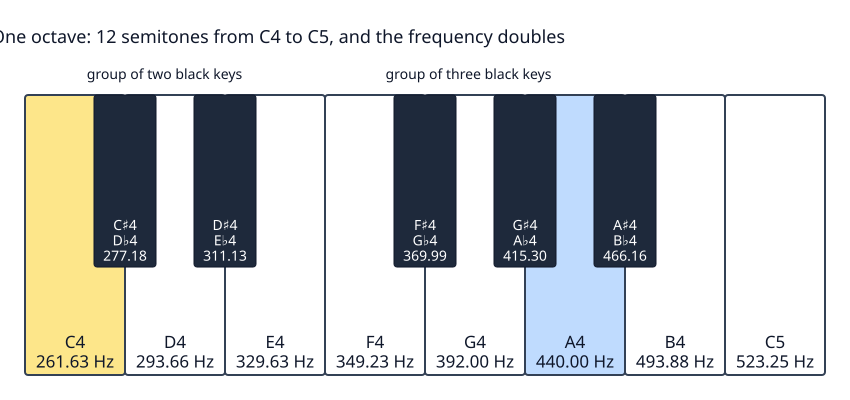
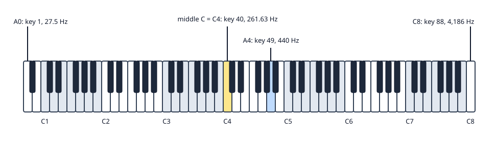
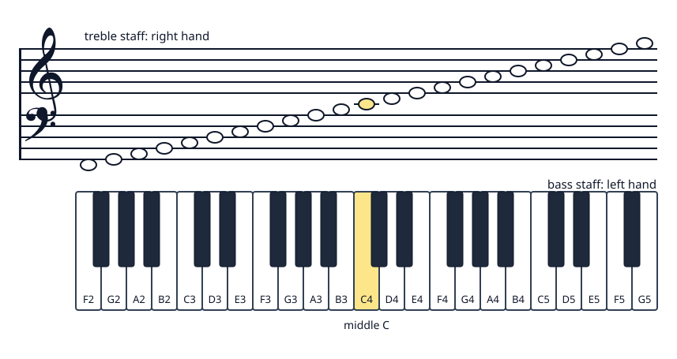
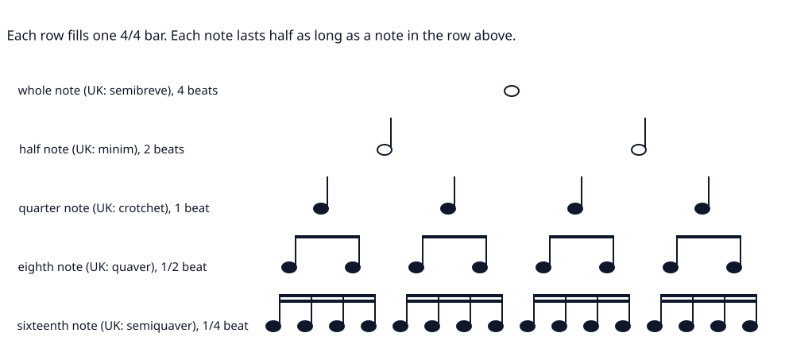

# How Music Works {#how-music-works}

> type: category

How does a note on paper become a sound, and how does a listener hear it? Music is sound arranged in time. Its basic building block is the note: one distinct sound with a pitch, a length and a loudness. The word also names the symbol that writes the sound on paper ([Musical note](https://en.wikipedia.org/wiki/Musical_note)). Pitch is how high or low a listener hears a sound.

A note travels along a path. A composer writes it on a score. A player reads the score and presses a key, bows a string or sings. The instrument makes the air vibrate, and the vibration reaches the ear of a listener, who hears a pitch again. This map follows one note along that path, in five parts:

- [Sound and Pitch](#sound-and-pitch): the sound of one note is a pressure wave that repeats. The wave is a sum of sine waves at whole multiples of one frequency, and the listener hears that frequency as the pitch.
- [The Pitch System](#pitch-system): Western music uses a fixed grid of pitches. The grid splits each octave, which is a doubling of frequency, into 12 equal steps called semitones.
- [The Piano Keyboard](#piano-keyboard): the piano has one key for each of 88 pitches of the grid, from 27.5 Hz to 4,186 Hz.
- [Sheet Music](#sheet-music): a score works like a plot of pitch against time. The height of a note on the staff gives its key, and the shape of the note gives its length.
- [Hearing Pitch](#hearing-pitch): the inner ear splits sound into frequency bands. Many musicians can hear the interval between two notes, but few people can name a single note.

Musicians also say tone. A musical tone is a steady periodic sound with a length, a pitch, a loudness and a timbre ([Musical tone](https://en.wikipedia.org/wiki/Musical_tone)). The word has two more meanings in music. A whole tone is a step of two semitones, and tone color is another name for [Timbre](#timbre), the sound quality that tells a piano from a violin.

## Sound and Pitch {#sound-and-pitch}

> type: category

A sound is a small change of air pressure that travels as a wave. A microphone at one point in the air turns the wave into a signal p(t). This part treats one note as that signal. It explains what the signal is made of, and which part of it the listener hears as the pitch.

### A Note Is a Sum of Harmonics {#harmonics}

> type: concept

The signal of a sustained note from a string, a wind instrument or a voice repeats with a period T. As a periodic signal, it is a Fourier series: a sum of sine waves at the fundamental frequency f0 = 1/T and at the whole multiples 2·f0, 3·f0, 4·f0 and so on. Each sine wave has its own amplitude and phase ([Musical tone](https://en.wikipedia.org/wiki/Musical_tone)). Musicians call these sine waves harmonics, and the list of them is the [harmonic series](https://en.wikipedia.org/wiki/Harmonic_series_%28music%29). The fundamental is the first harmonic. The tuning note of an orchestra, A4, is a combination of 440 Hz, 880 Hz, 1,320 Hz, 1,760 Hz and higher multiples ([Timbre](https://en.wikipedia.org/wiki/Timbre)).

A real note is more than this steady part. Its start, the attack, has transients that do not repeat, and its envelope and pitch can change while it sounds ([Musical tone](https://en.wikipedia.org/wiki/Musical_tone)).

The physics of the instrument makes the multiples. A string is fixed at both ends, so it vibrates only in modes that fit a whole number of half waves along its length. Mode n has the frequency n·f0, and the string vibrates in many modes at the same time. The air column of a wind instrument works the same way ([harmonic series](https://en.wikipedia.org/wiki/Harmonic_series_%28music%29)). In a piano, a bridge passes the vibration of the strings to the soundboard, which couples it to the air ([Piano](https://en.wikipedia.org/wiki/Piano)).

Three words name the parts of the spectrum. A partial is any sine component. A harmonic is a partial at a whole multiple of f0. An overtone is any partial above the lowest one. A pure tone is a single sine wave. A synthesizer can make one, and some flutes and ocarinas come close ([harmonic series](https://en.wikipedia.org/wiki/Harmonic_series_%28music%29)).

### Pitch Follows the Period {#pitch}

> type: concept

> edge.related: ear-filter-bank

Pitch is a perception of the listener, and frequency is a physical quantity that an instrument measures. The American National Standards Institute defines pitch as the attribute of sound that lets a listener order sounds from low to high ([Pitch](https://en.wikipedia.org/wiki/Pitch_%28music%29)). For a periodic or nearly periodic sound, the pitch is very close to the repetition rate 1/T, which is f0.

The ear finds the period even when the f0 component is absent. A sound made of only 1,000 Hz and 1,200 Hz repeats every 5 ms. A listener can hear a pitch of 200 Hz in it, in addition to the two tones ([Pitch](https://en.wikipedia.org/wiki/Pitch_%28music%29)). This effect is the missing fundamental. The heard pitch is usually the greatest common divisor of the frequencies that are present. A telephone passes little sound below 300 Hz, but a male voice with f0 near 150 Hz keeps its pitch on the phone. The brain computes the fundamental from the overtones ([Missing fundamental](https://en.wikipedia.org/wiki/Missing_fundamental)).

### Timbre Is the Shape of the Spectrum {#timbre}

> type: concept

Timbre, also called tone color, makes a guitar and a piano sound different when they play the same note at the same loudness. The Acoustical Society of America defines it as the attribute that lets a listener judge two sounds as different when they have the same loudness and pitch ([Timbre](https://en.wikipedia.org/wiki/Timbre)). Two physical properties set it:

- The spectrum: the relative amplitudes of the harmonics. Every instrument of an orchestra plays the A4 tuning note at 440 Hz, 880 Hz, 1,320 Hz and so on, and each instrument has its own balance of these amplitudes ([Timbre](https://en.wikipedia.org/wiki/Timbre)).
- The envelope: the change of amplitude over time. It is often described in four phases: attack, decay, sustain and release (ADSR). A piano note has a loud attack that fades fast, followed by a soft sustain ([Piano acoustics](https://en.wikipedia.org/wiki/Piano_acoustics)).

The player and the maker also shape the spectrum. A hard piano hammer makes loud, very high harmonics, so piano hammers have a felt cover that is soft enough to avoid them ([Piano](https://en.wikipedia.org/wiki/Piano)). Helmholtz stated that timbre depends on the amplitudes of the partials and not on their phases. Research since then shows that the ear acts as a simple Fourier analyzer only under restricted conditions ([Ohm's acoustic law](https://en.wikipedia.org/wiki/Ohm%27s_acoustic_law)).

### Real Partials Run Sharp {#inharmonicity}

> type: concept

The whole-number rule is exact for an ideal string, which bends with no resistance. A real piano string is stiff. Stiffness makes the string dispersive: the wave speed rises with frequency, so the upper partials sit a little above n·f0. This deviation is inharmonicity ([Inharmonicity](https://en.wikipedia.org/wiki/Inharmonicity)). In a piano, it grows toward both ends of the keyboard. A tuner sets each higher note so that its fundamental matches a sharp overtone of a lower note. As a result, the octaves of a tuned piano are slightly wider than 2:1. The Railsback curve shows how far each note sits from the grid formula, in cents ([Piano acoustics](https://en.wikipedia.org/wiki/Piano_acoustics)).

A bowed string, or an air column driven by a reed or by the lips, locks its partials to exact whole multiples. This effect is mode-locking. A struck or plucked string vibrates freely and keeps its inharmonicity ([Inharmonicity](https://en.wikipedia.org/wiki/Inharmonicity)). Tubular bells, timpani and marimbas have mostly inharmonic partials, but a few strong partials still give the ear a pitch. Cymbals make spectra rich in inharmonic partials, and they can give no sense of a particular pitch ([harmonic series](https://en.wikipedia.org/wiki/Harmonic_series_%28music%29)).

## The Pitch System {#pitch-system}

> type: category

A pitch system is the set of pitches that a music tradition uses. The distance between two pitches is an interval. Its exact size is the ratio of the two frequencies. Musicians name an interval by counting the letter names that it spans, both ends included: from B up to D is a third, because B, C and D are three letters ([Interval](https://en.wikipedia.org/wiki/Interval_%28music%29)).

Western music, the music tradition that grew in Europe, builds its pitch system in two steps. First, it gives notes an octave apart the same name. Next, it splits every octave into 12 equal steps. The steps are equal as frequency ratios, so the grid is uniform on a logarithmic frequency axis.

### Octave {#octave}

> type: concept

An octave is the interval between a pitch and the pitch with twice its frequency. A4 is 440 Hz, A5 is 880 Hz and A3 is 220 Hz ([Octave](https://en.wikipedia.org/wiki/Octave)). The octave is also the step from the first harmonic to the second. Western notation gives notes an octave apart the same letter name. Music theory calls all pitches with one name, in every octave, a pitch class. The pitch class C holds C1, C2, C3 and every other C ([Pitch class](https://en.wikipedia.org/wiki/Pitch_class)).

### Twelve Semitones {#twelve-semitones}

> type: concept

> edge.related: harmonics

Western music splits each octave into 12 equal frequency ratios. This tuning is twelve-tone equal temperament. One step is a semitone, with the ratio 2^(1/12), about 1.059463. Twelve semitones multiply to 2, which is one octave ([Piano key frequencies](https://en.wikipedia.org/wiki/Piano_key_frequencies)). The standard ISO 16 sets A4 to 440 Hz ([A440](https://en.wikipedia.org/wiki/A440_%28pitch_standard%29)). Every other pitch follows from it: the pitch n semitones above A4 has the frequency 440 × 2^(n/12) Hz, and a negative n gives a pitch below A4.

Musicians measure intervals in cents, a logarithmic unit. A semitone is 100 cents and an octave is 1,200 cents. The interval from f1 up to f2 is 1200 × log2(f2/f1) cents ([Cent](https://en.wikipedia.org/wiki/Cent_%28music%29)).

The equal steps come close to the whole-number ratios between neighboring harmonics. The fifths and fourths of the grid are almost exact, and its thirds are further away ([Equal temperament](https://en.wikipedia.org/wiki/Equal_temperament), [Interval](https://en.wikipedia.org/wiki/Interval_%28music%29)):

| Ratio | Pure interval | Nearest grid interval |
|---|---|---|
| 3:2, harmonic 2 to harmonic 3 | Fifth: 701.96 cents | 7 semitones: 700 cents |
| 4:3, harmonic 3 to harmonic 4 | Fourth: 498.04 cents | 5 semitones: 500 cents |
| 5:4, harmonic 4 to harmonic 5 | Major third: 386.31 cents | 4 semitones: 400 cents |

The 14-cent gap of the major third is large enough to hear ([Cent](https://en.wikipedia.org/wiki/Cent_%28music%29)). The harmonics of one note also land near grid pitches. For A4, the harmonic at 1,320 Hz is 2 cents above E6, the one at 2,200 Hz is 14 cents below C♯7, and the one at 3,080 Hz is 31 cents below G7. About the Numbers shows the calculation.

### Other Pitch Grids {#other-pitch-grids}

> type: concept

Other music traditions use pitches between the keys of the Western grid. An interval smaller than a semitone is a microtone ([Microtonality](https://en.wikipedia.org/wiki/Microtonality)). Four examples:

- Persian classical music lowers a note by about a quarter tone with the koron sign, and raises it by a quarter tone with the sori sign. A quarter tone is half a semitone, 50 cents ([Quarter tone](https://en.wikipedia.org/wiki/Quarter_tone)). The Iranian musician Alinaghi Vaziri set the standard use of the koron sign in the early 20th century ([Koron](https://en.wikipedia.org/wiki/Koron_%28music%29)).
- Arabic maqam music builds its scales from seconds of four sizes. One of them, the neutral second, lies between the minor second of one semitone and the major second of two semitones ([Arabic maqam](https://en.wikipedia.org/wiki/Arabic_maqam)).
- Indian music theory names 22 shrutis in an octave. A shruti is the smallest step of pitch, and the 7 swaras, the notes of a scale, are chosen from them ([Shruti](https://en.wikipedia.org/wiki/Shruti_%28music%29)).
- Indonesian gamelan music uses two tunings: slendro, with five notes per octave, and pelog, with seven. The exact pitches change from one ensemble to another ([Slendro](https://en.wikipedia.org/wiki/Slendro), [Pelog](https://en.wikipedia.org/wiki/Pelog)).

### Instruments and the Grid {#instruments-and-the-grid}

> type: concept

Instruments differ in the pitches that they can make. They fall into three kinds:

- Fixed pitch: each key, string, pipe or bar sounds one set pitch. The piano, the harp and the xylophone are examples, and a slide across one of them is a run of separate steps ([Glissando](https://en.wikipedia.org/wiki/Glissando)). The piano covers 27.5 Hz to 4,186 Hz. A large pipe organ goes lower: some organs have a pipe for C−1, which is 8 Hz and below the range of hearing ([Range](https://en.wikipedia.org/wiki/Range_%28music%29)).
- Continuous pitch: the player can set the frequency anywhere in a range. Examples are the violin, viola, cello and double bass, which have no frets, the trombone, the theremin and the human voice ([Glissando](https://en.wikipedia.org/wiki/Glissando)). The theremin is an electronic instrument. Its tone is the difference frequency of two radio-frequency oscillators, and the player detunes one of them with a hand near an antenna ([Theremin](https://en.wikipedia.org/wiki/Theremin)).
- No pitch: unpitched percussion, such as the snare drum, makes noise-like or inharmonic sound with no clear fundamental. It keeps the rhythm and adds accents ([Unpitched percussion instrument](https://en.wikipedia.org/wiki/Unpitched_percussion_instrument)).

Players of continuous-pitch instruments use pitches between the grid steps. Vibrato is a periodic frequency modulation of a note. A solo singer's vibrato usually swings less than 100 cents to each side of the note ([Vibrato](https://en.wikipedia.org/wiki/Vibrato)). These players can also tune an interval to an exact whole-number ratio, such as 5:4 for a major third. Such pure intervals are just intonation ([Just intonation](https://en.wikipedia.org/wiki/Just_intonation)).

The grid holds 120 equal-tempered notes from 16 Hz to 16,000 Hz, and a listener can tell about 1,400 pitch steps apart over the range of hearing ([Pitch](https://en.wikipedia.org/wiki/Pitch_%28music%29)). The range of an instrument is the span from its lowest to its highest pitch ([Range](https://en.wikipedia.org/wiki/Range_%28music%29)). The concert flute, for example, has a higher and narrower range than the piano, and flute players call C4 "low C" ([C (musical note)](https://en.wikipedia.org/wiki/C_%28musical_note%29)).

## The Piano Keyboard {#piano-keyboard}

> type: category

A modern piano has 88 keys: 52 white keys and 36 black keys ([Piano](https://en.wikipedia.org/wiki/Piano)). The lowest note is at the left. Each key is one semitone above its left neighbor, whatever its color ([Musical keyboard](https://en.wikipedia.org/wiki/Musical_keyboard)).

### Key Names {#key-names}

> type: concept

The keyboard repeats one pattern of 12 keys in every octave: 7 white keys and 5 black keys. The black keys sit in groups of two and three ([Musical keyboard](https://en.wikipedia.org/wiki/Musical_keyboard)). The picture shows the octave from middle C, C4, up to C5, with the name and the frequency of each key.



The white keys have the letter names C, D, E, F, G, A and B. C is the white key just left of each group of two black keys. A black key takes its name from a white neighbor. A sharp (♯) means one semitone higher and a flat (♭) means one semitone lower, so the black key between C and D is both C♯ and D♭. Two names for one key are enharmonic names ([Enharmonic equivalence](https://en.wikipedia.org/wiki/Enharmonic_equivalence)).

Most neighboring white keys are two semitones apart, which is a whole tone. E and F have no black key between them, and neither have B and C, so these pairs are one semitone apart. Each step to the next key multiplies the frequency by 1.059463. From C4 at 261.63 Hz, the twelfth key up is C5 at 523.25 Hz, twice the frequency.

### Octave Numbers {#octave-numbers}

> type: concept

A number after the letter gives the octave. In scientific pitch notation, the number goes up by one at each C, so B3 is followed by C4 ([Scientific pitch notation](https://en.wikipedia.org/wiki/Scientific_pitch_notation)). The 88 keys run from A0 at the left to C8 at the right. The picture shows the whole keyboard with every C named. The shading changes at each C, where a new octave number starts.



| Key | Name | Key number | Frequency |
|---|---|---|---|
| Lowest key | A0 | 1 | 27.50 Hz |
| Middle C | C4 | 40 | 261.63 Hz |
| Tuning note | A4 | 49 | 440.00 Hz |
| Highest key | C8 | 88 | 4,186.01 Hz |

Middle C is the fourth C from the left ([C (musical note)](https://en.wikipedia.org/wiki/C_%28musical_note%29)). Key number n has the frequency 440 × 2^((n − 49)/12) Hz ([Piano key frequencies](https://en.wikipedia.org/wiki/Piano_key_frequencies)). MIDI, the protocol that electronic instruments use to send notes, numbers the same pitches differently: middle C is MIDI note 60 and A4 is note 69 ([MIDI](https://en.wikipedia.org/wiki/MIDI)).

### What a Key Press Does {#key-press}

> type: concept

> edge.related: loudness-and-touch

Pressing a key makes a felt-covered hammer strike the strings of that note and fall back at once. A bass note has one string, a tenor note two and a treble note three. A bridge passes the vibration to the soundboard, which couples it to the air. A harder press makes the hammer hit harder and the note louder. When the key comes up, a damper stops the strings ([Piano](https://en.wikipedia.org/wiki/Piano)).

The pianist therefore controls three things for each note: which key, how hard, and how long the key stays down. These match the pitch, the loudness and the length that the score asks for. MIDI records a played note in the same terms. A note-on message carries the note number and a velocity, which tells how hard the key was struck, and a later note-off message ends the note ([MIDI](https://en.wikipedia.org/wiki/MIDI)).

The sustain pedal is the right pedal. It lifts all dampers, so the notes keep sounding after the keys come up ([Piano](https://en.wikipedia.org/wiki/Piano)).

## Sheet Music {#sheet-music}

> type: category

Sheet music, or a score, writes music as symbols on a staff. The staff works like a graph of pitch against time: a higher note sits higher, and the notes are played from left to right. The horizontal position gives the time only roughly. The shape of each note and the tempo give the exact timing ([Staff](https://en.wikipedia.org/wiki/Staff_%28music%29)). Notes stacked at the same horizontal place sound together as a chord, which is the sound of two or more notes at the same time ([Chord](https://en.wikipedia.org/wiki/Chord_%28music%29)).

Besides the pitch, a note on the page shows three more things. Its note value gives its length relative to the other notes. Its dynamics tell how loud to play it. Its articulation tells how to shape its attack and its end ([Musical note](https://en.wikipedia.org/wiki/Musical_note)). Rests mark silences, and the tempo sets the speed of the beat. The nodes below explain each part:

- Notes on the Staff: the pitch.
- Note Lengths and Rests: the length of each note and of each silence.
- Beat, Bar and Tempo: the speed.
- Loudness and Touch: the dynamics and the articulation.
- Reading and Playing a Piece: all of them together, at the piano.

### Notes on the Staff {#notes-on-the-staff}

> type: concept

> edge.related: key-names

A staff is five horizontal lines with four spaces between them. A note head sits on a line or in a space. When no sharp or flat applies, each step from a line to the next space up is one white key up ([Staff](https://en.wikipedia.org/wiki/Staff_%28music%29), [Musical keyboard](https://en.wikipedia.org/wiki/Musical_keyboard)). A clef at the left end of the staff fixes one line to one note, and the other positions follow from that line ([Clef](https://en.wikipedia.org/wiki/Clef)):

- The treble clef 𝄞, or G clef, puts G4 on the second line from the bottom. The curl of the clef wraps around that line.
- The bass clef 𝄢, or F clef, puts F3 on the fourth line from the bottom. The two dots of the clef sit above and below that line.

The clef signs grew out of the letters G and F, which scribes once wrote on the reference line ([Clef](https://en.wikipedia.org/wiki/Clef)).

Piano music uses the grand staff: two staves joined by a brace, with a treble staff above and a bass staff below. The right hand normally plays the upper staff, and the left hand plays the lower staff. Middle C sits between the two staves on a short extra line, a ledger line. Ledger lines extend a staff for notes above or below it ([Staff](https://en.wikipedia.org/wiki/Staff_%28music%29), [Ledger line](https://en.wikipedia.org/wiki/Ledger_line)).

The picture puts each line and space of the grand staff above its white key. Printed music leaves a wider gap between the two staves. The picture keeps every step the same height, so middle C sits exactly halfway between the staves.



Learners often memorize the line and space names with phrases ([Clef](https://en.wikipedia.org/wiki/Clef)):

| Staff | Lines, bottom to top | Spaces, bottom to top |
|---|---|---|
| Treble | E4 G4 B4 D5 F5: Every Good Boy Does Fine | F4 A4 C5 E5: FACE |
| Bass | G2 B2 D3 F3 A3: Good Boys Do Fine Always | A2 C3 E3 G3: All Cows Eat Grass |

#### Sharps, Flats and Key Signature {#accidentals}

> type: concept

An accidental is a sign in front of a note that moves the note by a semitone ([Accidental](https://en.wikipedia.org/wiki/Accidental_%28music%29)):

- A sharp (♯) raises the note one semitone: play the next key to the right.
- A flat (♭) lowers the note one semitone: play the next key to the left.
- A natural (♮) cancels a sharp or a flat.

An accidental also applies to later notes on the same line or space, up to the next bar line. A bar line is the vertical line that ends a bar of music, and Beat, Bar and Tempo explains bars. A key signature is a group of sharps or flats right after the clef. It applies to every note with that letter, in every octave, until the piece ends or a new key signature appears. For example, a flat in the top space of the treble staff turns every E into E♭, including E4 on the bottom line ([Key signature](https://en.wikipedia.org/wiki/Key_signature)).

### Note Lengths and Rests {#note-lengths}

> type: concept

The shape of a note gives its length relative to the other notes. The note head, the stem and the flags or beams show the value. Each value lasts half as long as the value before it ([Note value](https://en.wikipedia.org/wiki/Note_value)). Eighth notes and shorter notes are usually joined in groups by beams. American and British books use different names for the values, as the picture shows.



A rest is a silence of a set length. Each note value has a matching rest with its own sign, for example a quarter rest for the silence of one quarter note ([Rest](https://en.wikipedia.org/wiki/Rest_%28music%29)). A dot after a note makes it 1.5 times as long. A tie is a curved line between two notes of the same pitch. It joins them into one note that lasts as long as both together ([Dotted note](https://en.wikipedia.org/wiki/Dotted_note), [Tie](https://en.wikipedia.org/wiki/Tie_%28music%29)).

### Beat, Bar and Tempo {#beat-bar-tempo}

> type: concept

Players count time in beats. The time signature, two stacked numbers after the clef, sets the beat and groups the beats into bars, which are also called measures. The lower number names the note value that gets one beat: 2 is a half note, 4 a quarter note and 8 an eighth note. The upper number is the count of beats in one bar. In 4/4 time, one bar holds four quarter notes. The most common time signatures are 2/4, 3/4 and 4/4 ([Time signature](https://en.wikipedia.org/wiki/Time_signature)). Vertical bar lines separate the bars ([Bar](https://en.wikipedia.org/wiki/Bar_%28music%29)).

The tempo is the speed of the beat in beats per minute (BPM). A metronome mark such as ♩ = 120 asks for 120 quarter notes per minute. Many scores use an Italian word instead of a number, or with it. The words give only rough speeds, and the ranges below are for 4/4 time ([Tempo](https://en.wikipedia.org/wiki/Tempo)):

- Largo: slow and broad, about 40 to 66 BPM.
- Andante: at a walking pace, about 56 to 108 BPM.
- Allegro: fast and bright, about 120 to 156 BPM.
- Presto: very fast, about 168 to 200 BPM.

A note of b beats lasts b × 60 / BPM seconds. At ♩ = 120, one beat lasts 60 / 120 = 0.5 s:

| Symbol | Beats in 4/4 time | Seconds at ♩ = 120 |
|---|---|---|
| Whole note or whole rest | 4 | 2.0 |
| Half note or half rest | 2 | 1.0 |
| Dotted quarter note | 1.5 | 0.75 |
| Quarter note or quarter rest | 1 | 0.5 |
| Eighth note or eighth rest | 0.5 | 0.25 |

One bar of 4/4 time at this tempo lasts 2.0 s.

### Loudness and Touch {#loudness-and-touch}

> type: concept

Dynamics marks give the loudness. They are short forms of Italian words: p, for piano, means soft, and f, for forte, means loud. The scale runs pp, p, mp, mf, f and ff, from very soft to very loud. The marks are relative and set no level in decibels. A crescendo asks for a gradual rise in loudness, and a decrescendo asks for a gradual fall. Scores often draw them as hairpins that span several notes: an opening < for a crescendo and a closing > for a decrescendo ([Dynamics](https://en.wikipedia.org/wiki/Dynamics_%28music%29)). On the piano, a harder press of the key gives a louder note.

Articulation marks tell how a note starts, how long it really sounds and how it joins the next note ([Articulation](https://en.wikipedia.org/wiki/Articulation_%28music%29)):

- Staccato: a dot above or below the note asks for a short note with a silence after it ([Staccato](https://en.wikipedia.org/wiki/Staccato)).
- Legato: a slur, a curved line over or under notes of different pitches, asks for notes without gaps between them. A slur looks like a tie, but a tie joins notes of the same pitch ([Slur](https://en.wikipedia.org/wiki/Slur_%28music%29), [Tie](https://en.wikipedia.org/wiki/Tie_%28music%29)).
- Accent: a small horizontal wedge > on one note asks for a stressed start that then fades quickly ([Accent](https://en.wikipedia.org/wiki/Accent_%28music%29)). A hairpin is longer and spans several notes.

Piano scores also show where to use the sustain pedal ([Piano pedals](https://en.wikipedia.org/wiki/Piano_pedals)).

### Reading and Playing a Piece {#read-and-play}

> type: concept

A beginner can play a piece in this order:

1. Find the clefs. The right hand plays the treble staff, and the left hand plays the bass staff.
2. Read the key signature. Remember which letters are sharp or flat in the whole piece.
3. Read the time signature and the tempo. Count one bar of beats aloud at the tempo before you start.
4. For each note, find its line or space, name it from the clef, and find its key. Apply the key signature and any accidental earlier in the bar.
5. Press the key on its beat and hold it for the length of the note. At a rest, lift the hand. Press stacked notes together.
6. Add the dynamics and the articulation. Press harder for f and softer for p, and release early for staccato.

Numbers above or below the notes in beginner music give the fingering. On each hand, the thumb is 1, the index finger 2, the middle finger 3, the ring finger 4 and the little finger 5 ([Fingering](https://en.wikipedia.org/wiki/Fingering_%28music%29)).

An example: a bar on the treble staff in 4/4 time at ♩ = 120 holds a quarter note on the bottom line, a quarter note on the second line, a quarter rest and a quarter note in the third space. The clef names the three notes E4, G4 and C5. The right hand presses E4 at 0.0 s, G4 at 0.5 s, nothing at 1.0 s and C5 at 1.5 s, and it holds each key for 0.5 s. The bar ends at 2.0 s.

## Hearing Pitch {#hearing-pitch}

> type: category

Hearing turns the pressure wave back into notes. The inner ear splits the sound by frequency, and the brain turns the result into pitch, loudness and timbre. Two skills then differ a lot from person to person. Relative pitch, which is hearing the interval between two notes, is common among musicians. Absolute pitch, which is naming a single note with no reference, is rare.

### The Ear Splits Sound by Frequency {#ear-filter-bank}

> type: concept

Sound reaches the cochlea, a spiral tube in the inner ear that is filled with fluid. The basilar membrane runs along the tube. Each part of the membrane, together with the fluid around it, acts like a mass-spring resonator. Near the entrance of the tube, at the base, the membrane is stiff and light and responds to high frequencies. At the far end, the apex, it is floppy and heavy and responds to low frequencies. A sine tone therefore makes one place vibrate most. This map from frequency to place is called tonotopy ([Basilar membrane](https://en.wikipedia.org/wiki/Basilar_membrane)). About 3,500 inner hair cells along the membrane turn its motion into nerve signals ([Hair cell](https://en.wikipedia.org/wiki/Hair_cell)). Hearing research models each place as a band-pass filter, the auditory filter, and calls its bandwidth the critical band ([Critical band](https://en.wikipedia.org/wiki/Critical_band)).

The ear hears from about 20 Hz to 20,000 Hz, and the upper limit falls with age ([Hearing range](https://en.wikipedia.org/wiki/Hearing_range)). Above 1,000 Hz, a listener notices a change of about 0.6% in a sine tone, which is about 10 cents. Below 500 Hz, the smallest change that a listener notices is about 3 Hz for a sine tone and 1 Hz for a tone with harmonics ([Pitch](https://en.wikipedia.org/wiki/Pitch_%28music%29)). A semitone, by comparison, is 100 cents.

### Relative Pitch {#relative-pitch}

> type: concept

Relative pitch is the skill of naming or singing a note by its interval from a reference note. It is quite common among musicians. With it, a singer can read a melody from a score and pitch each note from the note before it, and a player of a fretless instrument can play in tune with others ([Relative pitch](https://en.wikipedia.org/wiki/Relative_pitch)).

People also remember the exact pitch of recordings that they know well, even when they cannot name the notes:

- Schellenberg and Trehub played 5-second excerpts of familiar TV theme songs to college students. Each excerpt was at its original pitch or moved up or down by 1 or 2 semitones, and the listeners picked out the original pitch level. The study concludes that good pitch memory is widespread among adults with no music training ([Schellenberg and Trehub 2003](https://doi.org/10.1111/1467-9280.03432)).
- Levitin asked 46 people to sing two popular songs from memory. Of them, 40% sang the pitch of the recording in at least one trial, and 44% came within two semitones in both trials ([Levitin 1994](https://doi.org/10.3758/BF03206733)).

### Absolute Pitch {#absolute-pitch}

> type: concept

Absolute pitch, often called perfect pitch, is the skill of naming or singing a note with no reference note ([Absolute pitch](https://en.wikipedia.org/wiki/Absolute_pitch)). Levitin splits it into two skills: pitch memory, which is common, and pitch labeling, which is less common ([Levitin 1994](https://doi.org/10.3758/BF03206733)).

How many people have absolute pitch is not known exactly. A rate of 1 in 10,000 is widely reported ([Absolute pitch](https://en.wikipedia.org/wiki/Absolute_pitch)). A 2019 review found a rate of at least 4% among music students ([Carden and Cline 2019](https://doi.org/10.1177/0305735619856098)). A test of music conservatory students in the United States and China found absolute pitch more often in students who started music training earlier. For each starting age, it was far more common in the Chinese students. They speak Mandarin, a tone language in which the pitch of a syllable changes the meaning of a word ([Deutsch and others 2006](https://doi.org/10.1121/1.2151799)).

### Pitch Compared With Color {#pitch-and-color}

> type: concept

> edge.related: octave, ear-filter-bank

Pitch and color share a structure. Hue is an attribute of color, such as red or blue. Chroma is the matching attribute of a pitch, and all pitches with one chroma form one pitch class, so C3 and C4 share the chroma C ([Pitch class](https://en.wikipedia.org/wiki/Pitch_class)). Chroma repeats every octave, and pitch height tells which octave a note is in ([Pitch](https://en.wikipedia.org/wiki/Pitch_%28music%29)).

Naming differs. Almost everyone names colors, but few people name pitches. Researchers compare absolute pitch with color naming: most people learn to name blue from the light they see, and people who hear notes together with their names early in life are more likely to name a C ([Absolute pitch](https://en.wikipedia.org/wiki/Absolute_pitch)).

The sense organs differ too:

- The eye has three types of cone cells, so it reduces the spectrum of any light to three numbers. Lights with different spectra can therefore look the same. Such lights are metamers ([Metamerism](https://en.wikipedia.org/wiki/Metamerism_%28color%29)).
- The ear analyzes the spectrum at many places along the basilar membrane. Two tones that are further apart than a critical band excite separate places, so the ear resolves them. Two tones closer than that interact, and the listener hears beats or roughness ([Critical band](https://en.wikipedia.org/wiki/Critical_band)).

## About the Numbers {#about-the-numbers}

> type: comment

The key counts, frequencies, cents and note lengths in this map come from the Python script below. It ran with Python 3.12 in November 2026. It uses twelve-tone equal temperament with A4 at 440 Hz. A tuned piano has stretched octaves, so its real frequencies differ from these values, most at the two ends of the keyboard. The pictures use the same values.

```python
import math

NAMES = ["A", "A♯/B♭", "B", "C", "C♯/D♭", "D", "D♯/E♭", "E", "F", "F♯/G♭", "G", "G♯/A♭"]


def key_name(n):
    """Name of piano key n (1 = A0, 88 = C8)."""
    octave = (n + 8) // 12
    return f"{NAMES[(n - 1) % 12]}{octave}"


def key_freq(n):
    """Frequency of piano key n in Hz, with key 49 (A4) at 440 Hz."""
    return 440 * 2 ** ((n - 49) / 12)


def cents(ratio):
    return 1200 * math.log2(ratio)


white = [n for n in range(1, 89) if "♯" not in key_name(n)]
print("keys:", 88, "white:", len(white), "black:", 88 - len(white))
for n in (1, 40, 49, 88):
    print(f"key {n} = {key_name(n)} {key_freq(n):.3f} Hz")
for n in range(40, 53):
    print(f"key {n} {key_name(n)} {key_freq(n):.2f} Hz")

for h in range(1, 9):
    f = 440 * h
    n = round(12 * math.log2(f / 440) + 49)
    print(f"{h} x 440 = {f} Hz, nearest key {key_name(n)} {key_freq(n):.2f} Hz, {cents(f / key_freq(n)):+.1f} cents")

for label, ratio, steps in (("fifth 3:2", 3 / 2, 7), ("fourth 4:3", 4 / 3, 5), ("major third 5:4", 5 / 4, 4)):
    print(f"{label}: {cents(ratio):.2f} cents; {steps} semitones = {steps * 100} cents")

bpm = 120
for label, beats in (("whole", 4), ("half", 2), ("dotted quarter", 1.5), ("quarter", 1), ("eighth", 0.5)):
    print(f"{label}: {beats} beats = {beats * 60 / bpm} s")
```

Some lines of its output:

- `keys: 88 white: 52 black: 36`
- `key 40 = C4 261.626 Hz` and `key 88 = C8 4186.009 Hz`
- `key 41 C♯/D♭4 277.18 Hz`
- `3 x 440 = 1320 Hz, nearest key E6 1318.51 Hz, +2.0 cents`
- `5 x 440 = 2200 Hz, nearest key C♯/D♭7 2217.46 Hz, -13.7 cents`
- `7 x 440 = 3080 Hz, nearest key G7 3135.96 Hz, -31.2 cents`
- `fifth 3:2: 701.96 cents; 7 semitones = 700 cents`
- `dotted quarter: 1.5 beats = 0.75 s`

The pictures are D2 diagrams. Their sources are the `.d2` files in the folder `music-d2-diagram`, next to this map, and the `d2` command renders each one to the `.d2.svg` image beside it. The clef signs in the staff picture are characters of a system font, Apple Symbols on macOS.
